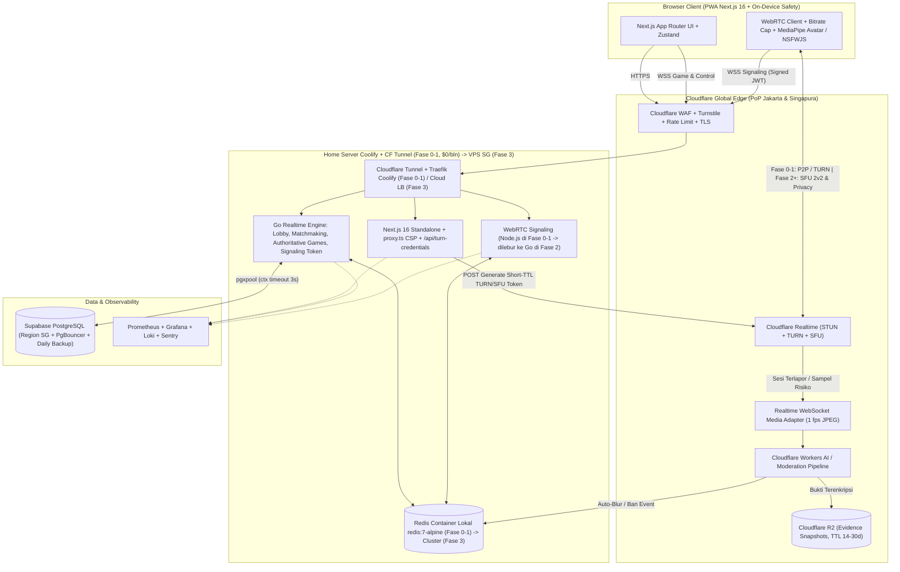

# Rencana Arsitektur, Audit, Keamanan & Roadmap Produk — Funfram

> **Dokumen Perencanaan Master (`docs/PLAN.md`)**  
> **Revisi:** v1.1 (19 November 2026 — Penyelarasan Keputusan Pemilik Proyek: Fokus Indonesia, Home Server \$0/bln, Semua 4 Game Aktif, Adaptive Bitrate 4-Tier, Tanpa Iklan di Awal)  
> **Lingkup:** Monorepo Funfram (`apps/frontend-nextjs`, `apps/backend-websockets`, `apps/backend-webrtc`, `infrastructure/postgres`, `docker-compose.yml`, `docs/*`)  
> **Mode Audit:** Read-only terhadap seluruh source code & dokumentasi (tanpa membaca `.env`/`.env.local`), diperkaya riset kompetitor & ekosistem media 2025–2026 serta referensi dokumentasi Next.js `16.2.7` (`node_modules/next/dist/docs/`).  
> **Riwayat Revisi:**  
> - `v1.0` (19 Nov 2026): Audit menyeluruh codebase, arsitektur media, riset kompetitor/regulasi, dan rencana Fase 0–3.  
> - `v1.1` (19 Nov 2026): Sinkronisasi penuh dengan keputusan pemilik proyek — fokus 100% pasar Indonesia (`lang="id"`), mempertahankan Home Server Coolify + CF Tunnel (\$0/bln) pada Fase 0–1, menjaga seluruh 4 mini-game langsung playable sejak Fase 0, skema *adaptive 4-tier bitrate* (`720×720` hingga `240p` PiP), menunda iklan/monetisasi hingga pasca-100 user pertama, serta jalur legalitas Perorangan/Individu tanpa PT/CV.

---

## 0. Ringkasan Eksekutif

Funfram sudah memiliki prototipe video chat acak berbasis *frame* (1–2 orang) dan 4 mini-game, namun **belum aman untuk trafik publik** karena 7 celah keamanan P0 (pembajakan sesi `REJOIN_SESSION`, *silent webcam/mic eavesdropping* di signaling Node, IDOR lintas-match, penyalahgunaan kuota Cloudflare TURN TTL 24 jam, invite HMAC di klien yang bahkan tidak diverifikasi, ketiadaan age-gate/moderasi, dan `.env` terancam ikut ke Docker image karena `.dockerignore` absen). Secara reliabilitas, audit menemukan *crash* fatal Go (`sync: unlock of unlocked mutex` & concurrent map write), *lock contention* global selama DB/network I/O, *infinite loop* multi-ronde `guess_drawing`, serta **bug fatal pada Chess & Ludo yang terkunci permanen setelah giliran pertama** akibat swap `leftParticipants`. Dari 23 hipotesis awal, **21 Terkonfirmasi** dan **2 Sebagian** (`R9`, `R11`), disertai **12 kelompok temuan tambahan**. Rekomendasi arsitektur & produk pasca-konfirmasi pemilik proyek (`v1.1`): (1) lakukan **Hotfix Keamanan & Crash P0 (Fase 0)** sekaligus perbaiki `localFrameRole` (`FE-06`) agar **semua 4 mini-game (`Guess Drawing`, `UNO`, `Chess`, `Ludo`) langsung playable dari awal** sebelum ditingkatkan menjadi *server-authoritative* penuh di Fase 1 (`GO-08`); (2) pertahankan **Home Server eksisting (Coolify + Cloudflare Tunnel + `redis:7-alpine` lokal)** bersama **Hardened Mesh P2P + Cloudflare TURN Free Tier (1 TB/bln)** dengan **4-Tier Adaptive Bitrate** (`720×720` hingga `240p` PiP) untuk beroperasi **\$0/bulan** selama Fase 0–1 hingga melewati target **100 user aktif pertama**, sebelum bermigrasi ke **Cloudflare Realtime SFU** (Fase 2) & **VPS Singapura** (Fase 3); (3) tunda iklan & paywall hingga sistem stabil dan basis 100 user pertama terbentuk; (4) fokus penuh pada pasar **Indonesia** (`lang="id"`) dengan diferensiasi **Co-Op Frame (bareng teman) + 4 Mini-Game + Mode Avatar MediaPipe**, kepatuhan keselamatan 18+, UU PDP, PP TUNAS, dan jalur legalitas **Perorangan/Individu** (OSS NIB → PSE Komdigi → Midtrans/Xendit Individual) tanpa perlu mendirikan PT/CV di tahap awal.

### Visi Produk

Menjadikan **Funfram** platform *live social discovery* berbasis web (PWA *zero-install*) nomor satu di **Indonesia** yang aman dan anti-canggung: pengguna dapat masuk solo atau mengajak 1 teman ke dalam satu **Co-Op Frame**, bertemu *frame* acak sesuai minat/vibe dalam Bahasa Indonesia, dan langsung mencairkan suasana lewat *ice-breaker* serta 4 mini-game interaktif — mengubah pengalaman "video chat acak yang canggung dan berisiko" menjadi ruang nongkrong digital yang hangat, terkurasi, dan mendorong pengguna kembali setiap hari.

---

## 1. Status Audit (Verifikasi Hipotesis Awal)

> **Catatan Metodologi:** Setiap hipotesis diverifikasi langsung terhadap source code (Go, Node.js, Next.js/TypeScript, SQL, Dockerfile, Compose) dan hasil `go vet ./...` (`go1.25.3`, 0 *static error* karena data race baru terdeteksi oleh `go test -race` dan saat ini terdapat **0 file test** di seluruh monorepo).

| ID | Status | Bukti Eksak (`file:fungsi:baris`) | Dampak | Severity |
| :--- | :---: | :--- | :--- | :---: |
| **S1** | **Terkonfirmasi** | `apps/backend-websockets/handlers.go:51-55` (`RejoinSessionPayload`), `:560-593` (`handleConnections` case `REJOIN_SESSION`); bocor lewat `hub.go:79-113,408-418` (`ToSession`, `createMatch`), `game.go:550-559`, dan `handlers.go:450-463` (`PLAYER_JOIN`/`FRAME_JOINED`). | Pembajakan sesi *online* maupun *reconnecting* oleh lawan match atau tamu lobi (termasuk mengambil alih hak `IsLobbyOwner`) hanya bermodal `userId`+`frameId` publik. | **P0** |
| **S2** | **Terkonfirmasi** | `apps/backend-webrtc/server.js:19-22` (tanpa Origin/CORS), `:65-67`, `:133-198` (`handleJoin`: percaya `userId`/`roomID`, kick socket lama `:158-168`, broadcast `peer-ready` tanpa otorisasi `:192-197`). | Penyerang dapat memutus panggilan korban, menyamar sebagai `sender`, **atau mengintip kamera & mikrofon korban diam-diam** (lihat Temuan T1). | **P0** |
| **S3** | **Terkonfirmasi** | `apps/backend-websockets/handlers.go:697-740` (`DEVICE_STATE_CHANGE`), `:962-979` (`MUTE_USER`), `:842-856` (`GAME_STOP`), `:833-840` (`GAME_DECLINE`), `:799-831` (`GAME_ACCEPT` + `hub.go:69-77` tanpa `PendingInviterID`). Juga meluas ke `SEARCH_START` (`:465-487`), `CANVAS_*` (`:880-904`), `REPORT_USER` (`:524-558`). | IDOR lintas-match & lintas-user: inviter bisa accept undangan sendiri, siapa pun bisa mematikan game/mute/ubah status kamera orang lain atau memaksa lobi lain masuk matchmaking. | **P0** |
| **S4** | **Terkonfirmasi** | `apps/backend-websockets/handlers.go:18-20` (`CheckOrigin` selalu `true`), `:228-311` (tanpa `ws.SetReadLimit`), hanya ada 1 rate limit (`FRAME_NEXT` 2s di `:494`), tanpa batas panjang/sanitasi `Username`/`ChatMessage`/`GuessText`/`Reason` (`:27-84,359,429,529,929-942`). | Rentan CSWSH, OOM DoS via payload WS raksasa, flooding chat/canvas/frame, serta CRLF *log injection*. | **P0** |
| **S5** | **Terkonfirmasi** | `apps/frontend-nextjs/src/app/api/turn-credentials/route.ts:3-5` (`ipRateLimitMap` tanpa cleanup), `:7-13` (`getClientIp` pakai `x-forwarded-for` elemen 0), `:32-60` (`isAllowedCaller`: `X-Funfram-Client: 1` trivial di-spoof, `Origin` opsional & bypass `startsWith('http://localhost')` di `:50`), `:116` (`ttl: 86400`). | Penyalahgunaan kuota Cloudflare TURN (tagihan egress $0.05/GB tidak terkontrol) oleh script eksternal dengan kredensial hidup 24 jam + memory leak OOM di server Next.js. | **P0** |
| **S6** | **Terkonfirmasi** | `apps/frontend-nextjs/src/services/hmac.ts:11` (`SIMULATED_SECRET_KEY` di client bundle), `:65-81` (`verifySimulatedToken` dead code); `api.service.ts:48-84` (`verifyInviteLink` abaikan `signature`/`nonce` + bypass `NaN` `:70-76`); `page.tsx:140` tidak kirim token; `database.go:144-153,377-417` (`invite_links`, `CreateInviteLink`, `ValidateInviteLink`) dead code; `FRAME_JOIN` tak ada di `handlers.go`. | Sistem undangan tidak memiliki keamanan kriptografis sama sekali; siapa pun yang menebak/mengendus UUID `frameId` bisa masuk tanpa tanda tangan valid atau link kadaluarsa. | **P1** |
| **S7** | **Terkonfirmasi** | `apps/frontend-nextjs/src/components/auth/auth.tsx:1-84`, `JoinFrameClient.tsx:1-153`, `VideoTile.tsx:157-165,175-185`; `handlers.go:524-537` (`REPORT_USER` hanya `fmt.Printf` + `hub.BlockUser` in-memory `hub.go:304-318`); `init.sql` tanpa tabel `reports`/`bans`/age-consent. | Risiko hukum, keselamatan anak, eksposur konten NSFW langsung di layar, dan pelanggar cukup *reload* halaman untuk mendapat `userId` baru dan membypass blokir. | **P0** |
| **R1** | **Terkonfirmasi** | `apps/backend-websockets/game.go:545-560` (`finishGame` mengirim `GAME_END` lalu `MATCH_FOUND` ulang); `useCallSignaling.ts:261-266` (`onMatchFound` hapus `generalChat` & panggil `connectWebRTC` → `:93` `webrtc.leaveCurrentRoom()` di `webrtc.service.ts:712-735`); `useCallStore.ts:295-301` tidak menjaga stream remote/teammate. | Setiap game berakhir alami, seluruh panggilan WebRTC diputus-sambung ulang (video berkedip/putus audio 2–5 detik) dan seluruh chat terhapus. | **P1** |
| **R2** | **Terkonfirmasi** | `apps/backend-webrtc/server.js:88-92,226-249` (`handleDisconnect` langsung hapus socket & broadcast `user-left` tanpa grace period); `webrtc.service.ts:330-333` langsung `pc.close()`, plus `:266-269` (`signalingSocket.onclose`) **tanpa auto-reconnect**. | Gangguan jaringan singkat (<2 detik) atau handover Wi-Fi↔4G langsung memutus media WebRTC secara permanen meski sesi Go masih dalam grace period 12 detik. | **P1** |
| **R3** | **Terkonfirmasi** | `apps/backend-websockets/handlers.go:596` (`FRAME_LEAVE` set `client.ExplicitLeave = true` sebelum validasi payload); `:323-388` (`FRAME_CREATE`) dan `:390-463` (`PLAYER_JOIN`) / `hub.go:203-207` tidak mereset `ExplicitLeave = false`; hanya direset di `REJOIN_SESSION` (`:574`). | Setelah keluar frame lalu membuat/bergabung frame baru pada socket yang sama, grace period 12 detik tidak aktif sehingga gangguan jaringan langsung menghancurkan lobi/match. | **P1** |
| **R4** | **Terkonfirmasi** | `hub.go:31-39` (`Client.Send` tanpa `SetWriteDeadline`); `hub.go:320-373` (`AddToMatchmaking` pegang `h.mu.Lock()` saat panggil `broadcastEventToLobbyLocked` `:336` & `createMatch` `:360`); `createMatch` (`:375-419`) memanggil **3 query PostgreSQL sinkron** (`:379,385-386`) + `MATCH_FOUND` `:410-418` di bawah `h.mu.Lock()`; `game.go:548-560` & `:340-412` juga kirim WS di bawah lock. | Satu klien lambat/blackhole atau latensi Supabase 2 detik membekukan **seluruh Hub** untuk semua pengguna di server. | **P0** |
| **R5** | **Terkonfirmasi** | `handlers.go:254-265` vs `:578` (closure race `client` + fatal `sync: unlock of unlocked mutex`); `:378,386` (iterasi `lobby.Members` pasca-unlock vs `hub.go:209` fatal map crash); `:572` vs `hub.go:38` (`Client.Conn`); `:286-291` vs `:568-574` (`ExplicitLeave`/`Presence`/`DisconnectTimer`); `hub.go:32` (`json.Marshal` `*Client` tanpa lock). | Crash proses server tiba-tiba (*fatal concurrent map read/write* & *unlock of unlocked mutex*) serta state klien/presence korup di bawah trafik konkuren. | **P0** |
| **R6** | **Terkonfirmasi** | `hub.go:124-131` (tanpa index `lobbyID -> matchID`, semua state in-memory); iterasi linear `hub.matches` di `handlers.go:114,612,718,755,868,883,909,947` (termasuk setiap frame `CANVAS_MOVE` 60fps); `AddToMatchmaking` 3× scan `O(n)` (`hub.go:340-371`); `BroadcastOnlineCount` `O(N)` per join/leave (`hub.go:267-287`). | CPU lock contention melonjak kuadratik saat CCU naik; tidak dapat di-scale horizontal (>1 replica memecah matchmaking & room); semua sesi hilang saat restart. | **P1** |
| **R7** | **Terkonfirmasi** | `database.go:522-552` (`UpdateScore` menimpa skor & non-atomik); `:184-211` (`GetOrCreateUser` tambah suffix `UnixNano()%10000` → 1 row `users` per frame/join, `GetLeaderboard` `:554-586` dead); **semua** query DB memakai `context.Background()` tanpa timeout (`:48..559`) secara sinkron di read loop `handleConnections`. | Tabel `users` membengkak tak terkendali, leaderboard tidak bermakna, risiko tabrakan suffix 4-digit, dan read loop klien terblokir saat DB melambat. | **P1** |
| **R8** | **Terkonfirmasi** | `useCallSignaling.ts:420-423` menunggu `errorMsg === 'frame idle timeout'`; di Go `hub.go:48` (`Lobby.LastActivity`) hanya ditulis di `CreateLobby` (dead) & `AddToMatchmaking` (`:329`), tidak pernah dibaca; tidak ada goroutine janitor di `apps/backend-websockets/`. | Lobi yatim/idle menumpuk di memori dan tabel DB `lobbies` tidak pernah berstatus `CLOSED`; ekspektasi timeout 5 menit di UI tidak pernah terpicu. | **P2** |
| **R9** | **Sebagian** | Mesh 4 peserta (3 PC/klien) & tanpa `maxBitrate`/simulcast (`webrtc.service.ts:11`, `useLocalMedia.ts:38-43` minta 1280×1280!) = **Terkonfirmasi**; Perfect Negotiation palsu (`makingOffer`/`ignoreOffer`/`isSettingRemoteAnswerPending` di `:22-24,410-412` tak pernah dibaca) = **Terkonfirmasi**. **Koreksi stats:** `jitter` (`:123,129`) memang tak dipakai & nol adaptasi bitrate, **namun** `networkQuality` (`:98-144`) **dipakai** di UI bar sinyal `VideoTile.tsx:154-155,225-234` (meski perhitungan packet loss-nya kumulatif, bukan delta). | Upload seluler membengkak (3× stream HD) + biaya TURN melonjak, glare `InvalidStateError` saat ICE restart serentak, indikator kualitas jaringan makin tak akurat seiring durasi call. | **P1** |
| **R10** | **Terkonfirmasi** | `handlers.go:858-878` (`GAME_ACTION` blind relay); `UnoGame.tsx:14-24,110-140` (seluruh `deck` & `hands` dikirim ke semua klien); `ChessGame.tsx:198-206` & `LudoGame.tsx:89-108` (`Math.random()` & seluruh state dari klien); `game.go:649-661` (`trimLower` hapus semua non-`[A-Za-z]` + konkatenasi `O(n^2)`). | Cheating trivial di Chess/Ludo/UNO, kartu lawan UNO terbaca di DevTools/console, dan `trimLower` menerima string sampah atau memicu tebakan kosong lolos jika kata berangka/non-ASCII. | **P1** |
| **R11** | **Sebagian** | Di `useCallStore.ts`: `sendGeneralMessage` (`:400-416`, hanya mutasi lokal) & `reportUser` (`:578-580`, hanya `console.log`) memang **tidak mengirim WS** dan merupakan dead code. **Namun di UI aktif**, `SidebarChat.tsx:26` dan `VideoTile.tsx:158` mem-bypass store dan **benar-benar mengirim** `CHAT_MESSAGE` & `REPORT_USER` langsung via `WebSocketService`. | Chat & tombol Report saat ini berfungsi di UI, tetapi arsitektur state terbelah (store vs komponen) membingungkan pengembang dan rawan regresi jika komponen baru memanggil action store mati tersebut. | **P3** |
| **I1** | **Terkonfirmasi** | `docs/architecture.md:9-21,44`, `docs/deployment.md:63-66` (1 home server CGNAT + `cf-tunnel`); 0 file test di `git ls-files`, `backend-webrtc/package.json:8` (`no test specified`); 0 `.github/workflows/`; 0 Prometheus/OTel/Sentry/`slog`/`pino`; `/health` statis (`main.go:34-38`, `server.js:10-14`). | *Single Point of Failure* (mati listrik/ISP rumah = total outage), kebutaan operasional saat insiden, dan deploy langsung ke produksi tanpa gerbang kualitas. | **P1** |
| **I2** | **Terkonfirmasi** | `apps/backend-websockets/Dockerfile:1-21` (root, `alpine:latest` tanpa `ca-certificates`, tanpa `HEALTHCHECK`); `apps/backend-webrtc/Dockerfile:1-12` (root, `npm ci --production` deprecated, single-stage, tanpa `HEALTHCHECK`); `apps/frontend-nextjs/Dockerfile:1-34` (root, `npm install`, tanpa `HOSTNAME=0.0.0.0`, tanpa `HEALTHCHECK`). | Risiko eskalasi hak akses container, gagal verifikasi TLS Supabase (`x509`) di Go, build tidak reproducible, serta container *unhealthy* tidak otomatis di-restart orchestrator. | **P1** |
| **I3** | **Terkonfirmasi** | `docker-compose.yml:6-18` (hanya `environment:`, tanpa `build.args:`) vs `apps/frontend-nextjs/Dockerfile:11-19` (`ARG NEXT_PUBLIC_*` dibutuhkan saat `npm run build`). | Build Docker Compose selalu meng-inline `NEXT_PUBLIC_*` sebagai `undefined` di client bundle sehingga selalu fallback ke `ws://localhost:5001` & `5002`. | **P2** |
| **I4** | **Terkonfirmasi** | `.env.example:3-4,21,27,30-49` (2× `PORT` bentrok, Coturn/OpenRelay basi, URL internal Docker tak bisa diakses browser, domain prod bocor `:13-15`); `.npm-cache/` (5 file ter-track git, absen di `.gitignore`); root `package.json:1-16` duplikasi Next `^16.2.9`/TS `^6.0.3` beda dari `apps/frontend-nextjs/package.json` (`16.2.7`/TS `^5`); 8 file orphan FE + 13 fungsi dead BE + duplikat `handlers.go:418-426`; `ensureSchema` (`database.go:67-171`) divergen dari `init.sql`; `presence_state` CHECK (`init.sql:57`, `database.go:119`) kurang `DRAWING`/`GUESSING`/`RECONNECTING`. | Onboarding & build lokal membingungkan, konflik workspace Next.js standalone, bloat repo, dan error DB tersembunyi akibat schema drift. | **P2** |
| **I5** | **Terkonfirmasi** | `webrtc.service.ts:76` (`console.log` TURN `username`+`credential` 24 jam!), `:444-450` (IP/port ICE); `websocket.service.ts:69` (`console.debug` semua payload termasuk kartu UNO & kata rahasia); `handlers.go:267,320,529,583,1033` (stdout cetak tiap event, IP, `userId`+`frameId`, input mentah); `server.js:62,81,114,125,173` (log flood & raw Metered error). | Kebocoran kredensial TURN & privasi pengguna di browser, paparan pasangan kredensial `REJOIN_SESSION` di log server, serta log-flooding disk penuh (tanpa log rotation Docker). | **P1** |

---

## 2. Temuan Tambahan Hasil Audit (Di Luar Daftar Hipotesis Awal)

| ID | Severity | Area | Temuan & Bukti Eksak (`file:fungsi:baris`) | Dampak |
| :--- | :---: | :--- | :--- | :--- |
| **T1** | **P0** | Keamanan WebRTC | **Silent Camera/Mic Eavesdropping:** Siapa pun yang tahu `roomID` (`frameId`/`sessionId`) dapat `join` dengan `userId` baru di `apps/backend-webrtc/server.js:133-197`. Server otomatis mengirim `peer-ready` (`role: 'offerer'`) ke semua korban di room → `webrtc.service.ts:313-315,348-382` otomatis memasang live webcam & mikrofon dan mengirim SDP offer ke penyerang. Jika penyerang membalas `recvonly` tanpa track, `onRemoteStream` (`useCallSignaling.ts:96-129`) tidak terpanggil sehingga korban tidak tahu sedang diintip. | Pelanggaran privasi ekstrem (spying kamera/audio tanpa indikator di UI korban). |
| **T2** | **P0** | Stabilitas Go | **2 Kondisi Fatal Crash Runtime Go:** (1) `handlers.go:254-265` (ping goroutine) mengakses closure `client.WriteMu.Lock()/Unlock()` sementara `REJOIN_SESSION` menimpa variabel `client = existing` di `:578` → `fatal error: sync: unlock of unlocked mutex`; (2) `handlers.go:386` (`FRAME_CREATE`) memanggil `lobby.ToFrame().Members` (iterasi map `lobby.Members` `hub.go:81`) *setelah* `hub.mu.Unlock()` (`:378`), bersaing dengan `hub.JoinLobby` (`hub.go:209`) → `fatal error: concurrent map iteration and map write`. | Seluruh server Go crash seketika (tidak bisa ditangkap `recover()`), memutus semua pengguna aktif. |
| **T3** | **P0** | Keamanan Go | **`SEARCH_START` Cross-Lobby Takeover & `REPORT_USER` Skip Bypass:** `handlers.go:465-487` (`SEARCH_START`) memakai `payload.FrameID` tanpa cek `client.IsLobbyOwner` maupun `payload.FrameID == client.LobbyID`, dan memaksa `lobby.Status = "WAITING"` (`:478`) pada lobi yang sedang `MATCHED` (memicu *double-match*). Di `:524-558` (`REPORT_USER`), tamu non-owner bisa mengirim target sembarang untuk memicu `cleanupMatchForLobby` dan membypass larangan `FRAME_NEXT` + rate limit 2 detik. | Gangguan layanan terarah (*griefing*) & korupnya state matchmaking. |
| **T4** | **P0** | Gameplay FE | **Chess & Ludo 100% Unplayable Setelah Giliran 1 + UNO Dual-Host Race:** `useCallStore.ts:285-315` (`setSession`) selalu menempatkan frame user lokal ke `leftParticipants`. Akibatnya: `ChessGame.tsx:129-134` menjadikan **kedua sisi Putih (`'w'`)** (papan terkunci permanen saat giliran `'b'`); `LudoGame.tsx:70-75` menjadikan **kedua sisi Merah (`'red'`)** (soft-lock di giliran `'blue'`); `UnoGame.tsx:104-117` menjadikan **kedua owner Host** yang men-deal 2 deck berbeda dan saling menimpa! | 3 dari 4 mini-game yang ditampilkan di modal (`GameInviteModal.tsx:23-28`) rusak berat di produksi. |
| **T5** | **P0** | Gameplay Go | **Multi-Round `guess_drawing` Infinite Loop + Timer Race + 2v2 Canvas Blindness:** (1) `game.go:401-407` (`SubmitGuess`) mencari `qIdx` dari indeks `0` dan berhenti di kemunculan pertama `CurrentDrawerID`; pada ronde ≥2 (`Queue` berulang `[A,B,A,B]`), `qIdx` selalu `0` → `revealAnswer(0)` → `runRound(1)` berputar selamanya (+ pertumbuhan stack rekursif `:225,466`); (2) Race antara timer habis (`:337`) vs `go ge.revealAnswer` (`:410`) menimpa `Winner = nil` sementara skor tetap bertambah; (3) `handlers.go:880-904` (`CANVAS_*`) hanya broadcast ke `partnerLobbyID`, sehingga rekan 1 frame di 2v2 tidak melihat gambar; (4) `game.go:433` mengisi `winnerId` dengan username & hint `:248-259` menghapus spasi/tanda hubung. | Mode multi-ronde dan mode 2v2 (nilai jual inti Funfram!) gagal dimainkan dengan benar. |
| **T6** | **P0** | Keamanan Docker | **`.dockerignore` Absen & Masuk `.gitignore:50`:** Tidak ada `.dockerignore` di root maupun ketiga app, dan `.gitignore:50` justru meng-ignore `.dockerignore`! Dampaknya, `COPY . .` di `backend-webrtc/Dockerfile:8` (single-stage), `frontend-nextjs/Dockerfile:9`, dan `backend-websockets/Dockerfile:9` menyalin `.env`/`.env.local`, `node_modules/` host (menimpa hasil `npm ci` di `backend-webrtc`!), dan biner 14.8 MB `funfram-websockets.exe` ke build context/image produksi. | Kebocoran secret `.env` langsung ke Docker image & image bloat/korup. |
| **T7** | **P1** | Reliabilitas FE/RTC | **Hilangnya Event/Koneksi Saat Reconnect:** (1) `webrtc.service.ts:266-269` tanpa auto-reconnect signaling; (2) `useCallSignaling.ts:77-139` (`connectWebRTC`) tidak mengecek ulang `currentGeneration` di dalam `.then()` (`:131-135`) dan membaca snapshot `store` basi (`:80`); (3) `websocket.service.ts:126-139` (`sendWhenOpen`) menempelkan listener `open` hanya ke instance `this.ws` lama — bila koneksi awal gagal lalu reconnect membuat socket baru, `FRAME_CREATE`/`PLAYER_JOIN` hilang selamanya; (4) `webrtc.service.ts:477-487` langsung menimpa status `'reconnecting'` dengan `pc.iceConnectionState`. | Layar macet saat startup di jaringan mobile, salah join room saat skip cepat, dan audio/video mati total setelah drop sesaat. |
| **T8** | **P1** | Database/SQL | **`user_device_state` 100% Gagal FK + Bug UTF-8 + `init.sql` Non-Idempoten:** `init.sql:77` & `database.go:137` memasang FK `user_device_state.session_id REFERENCES sessions(id)`, tetapi `CreateSessionDB` (`:360-375`) dead code (`sessions` selalu kosong) sementara `handlers.go:727` mengirim `matches.id` → 100% gagal FK (ditelan `_ =`). Tambahan: `database.go:194-196` `baseName[:44]` memotong per-byte (bisa membelah karakter UTF-8/emoji → error Postgres); `init.sql:97-109,130-138` tanpa `IF NOT EXISTS`/`DROP TRIGGER IF EXISTS`; `AddLobbyMember` tanpa `ON CONFLICT DO NOTHING`. | Pencatatan device state di DB mati total; username ber-emoji/panjang bisa gagal insert Postgres. |
| **T9** | **P1** | Memory/Goroutine Leak | **Leaks & Zombie Resources:** (1) `FRAME_CREATE` berulang pada 1 WS (`handlers.go:323-378`) menimpa `client.ID`/`LobbyID` tanpa membersihkan lobi & entri `hub.clients` lama; (2) `hub.LeaveLobby` (`:228-259`) tidak mereset `client.LobbyID`/`IsLobbyOwner` sehingga eks-member tetap bisa chat/kontrol game; (3) `REJOIN_SESSION` (`handlers.go:572`) tidak menutup `oldWS` → 2 read-loop aktif pada 1 `Client`; (4) Ping goroutine (`handlers.go:254-265`) tanpa stop channel; (5) Tanpa HTTP server timeout (`main.go:71` rentan Slowloris) & tanpa graceful shutdown `SIGTERM` (`main.go:22`, `server.js:251`); (6) `streamInterval` (`useCallSignaling.ts:62-67`) jalan selamanya bila izin kamera ditolak; (7) `finalizeClientDisconnect` tamu (`handlers.go:213-219`) lupa broadcast `PLAYER_LEFT` ke `partnerLobbyID`. | Kebocoran memori/goroutine bertahap, `ONLINE_COUNT` meleset naik, dan *zombie connections*. |
| **T10** | **P1** | Keamanan & CVE | **CVE Dependensi Go, Zero Security Headers, & Bypass Validasi:** (1) `apps/backend-websockets/go.mod:7` memakai `pgx/v5 v5.5.0` (**CVE-2024-27304** SQL injection via protocol overflow), `golang.org/x/crypto v0.9.0` (CVE-2023-48795/2024-45337/2025-22869), dan `go 1.23` (EOL); (2) `next.config.ts:1-7` tanpa CSP, `X-Frame-Options`/`frame-ancestors` (clickjacking izin kamera!), `Referrer-Policy` (bocor query `/join-frame?invite=...`), `Permissions-Policy`, `HSTS`; (3) `route.ts:50` `origin.startsWith('http://localhost')` lolos domain `http://localhost.evil.com` & `:51` `new URL(appUrl)` di luar `try/catch` (crash 500); (4) `api.service.ts:70-76` bypass expiry via `?expire=invalid` (`NaN`); (5) `server.js:175` memanggil Metered API sia-sia tiap `join` padahal FE mengabaikan `ice-servers` (`webrtc.service.ts:298-300`); (6) `backend-websockets/hub.go:154` pakai `math/rand` bukan `crypto/rand` untuk invite code. | Eksploitasi CVE protokol DB, clickjacking kamera/mikrofon, kebocoran invite via Referer, dan pemborosan kuota API Metered. |
| **T11** | **P1** | UX & Media FE | **Bug Media & Kontrol UI Kritis:** (1) `Navigation.tsx:29,31` menerima `onCam`/`isCamOn` tapi tidak merender `CameraButton` — user tak bisa matikan/nyalakan kamera; (2) `useLocalMedia.ts:194-231` (`flipCamera`/`selectDevices`) memanggil `track.stop()` *sebelum* `getUserMedia` berhasil (kamera mati permanen saat gagal flip di laptop 1 kamera); (3) `useLocalMedia.ts:289-301` (`handleCam`) tetap broadcast `cameraEnabled: true` walau `startCamera()` gagal & `startCamera()` tidak memanggil `webrtc.setLocalStream`; (4) `Navigation.tsx:59-88` menekan `Esc` untuk menutup `CustomAlertModal` malah memicu `triggerNextFrame()` (skip lawan!); (5) `VideoTile.tsx:175-216` tampilkan video hitam saat `isCameraOff` alih-alih avatar; (6) Transisi `MeetingScene`↔`GameScene` (`page.tsx:183-187`) meng-unmount `<video>` (risiko autoplay block Safari/iOS); (7) `useCallStore.ts:433-447` (`acceptGameInvite`) *optimistic switch* ke `PLAYING` tanpa set `activeGameType`. | Pengalaman pengguna rusak pada aksi dasar (flip kamera, toggle kamera, tekan Esc, iOS Safari). |
| **T12** | **P2** | Performa, A11y & Docs | **Performa, A11y, Tooling & Documentation Drift:** (1) `GuessDrawingGame.tsx:93-128` redraw seluruh riwayat kanvas `O(N^2)` + 1 WS event tiap `pointermove` tanpa throttle; (2) `FloatingBackgroundIcons.tsx:16-48` merender 150 SVG beranimasi terus-menerus di atas video WebRTC; (3) `public/mockup1.png` (1.60 MB) + `mockup2.png` (1.66 MB) = 3.26 MB PNG mentah via `` (LCP buruk) + `favicon.ico` 263 KB; (4) `hub.go:267-287` `BroadcastOnlineCount` memicu `O(N^2)` message storm saat banyak user masuk; (5) Semua modal & tombol icon-only kurang `role="dialog"`, `aria-modal`, `aria-label`, `htmlFor`, serta PiP mobile `GameVideoDock.tsx` memotong popup device/report; (6) `apps/frontend-nextjs/package.json:6-7` memakai `--webpack` di dev vs Turbopack di prod; (7) Drift parah di `docs/protocol.md` (`GAME_STOP` wajib `{sessionId}`, `REJOIN_SESSION` & `GAME_ACTION` absen, semua event Server→Client absen), `docs/deployment.md:74` (uji `/api/turn-credentials` tanpa header pasti 403), dan `apps/frontend-nextjs/README.md` (masih template `create-next-app`). | Lag di perangkat mobile kelas menengah, skor Lighthouse/LCP rendah, kesulitan aksesibilitas, dan jebakan bagi developer baru. |

---

## 3. Analisis Kompetitor & Posisi Diferensiasi Funfram

> **Status Industri:** **Omegle resmi tutup permanen pada November 2023** setelah 14 tahun beroperasi, karena krisis moderasi anonim, penyalahgunaan terhadap anak di bawah umur, dan tekanan gugatan hukum/finansial (sumber: AP News & surat perpisahan pendiri Leif K-Brooks, Nov 2023). Pasca-penutupan Omegle, standar industri bergeser drastis: **moderasi AI + manusia 24/7, verifikasi usia ketat, dan kepatuhan App Store/regulasi menjadi prasyarat bertahan hidup**.

### 3.1 Matriks Perbandingan Kompetitor Aktif (2025–2026)

| Aspek | **OmeTV** (`ome.tv`) | **Umingle** (`umingle.com`) | **Chatroulette** (`chatroulette.com`) | **Emerald Chat** (`emeraldchat.com`) | **Azar** (`azarlive.com`) & **Monkey** (`monkey.app`) | **Funfram** *(Saat Ini → Target)* |
| :--- | :--- | :--- | :--- | :--- | :--- | :--- |
| **Status (2026)** | Aktif, pangsa trafik besar (sangat populer di Indonesia/SEA). | Aktif, alternatif Omegle modern *browser-first* + Android. | Aktif, pelopor 2009 yang dirombak dengan AI moderasi ketat. | Aktif, fokus komunitas & sistem Karma anti-bot. | Aktif (Azar oleh Hyperconnect/Match Group; Monkey fokus Gen Z). | Prototipe awal → **Target: Co-Op Video + Game Web Platform**. |
| **Fitur Utama & Filter** | Video 1v1 + teks terjemahan otomatis; filter negara & gender (wajib login akun sosial). | Video 1v1 & teks-only; filter tag minat/topik; filter negara/bahasa (tier berbayar). | Video 1v1 instan, filter negara, mata uang internal (*Quids*) untuk prioritas. | Video 1v1, teks, group chat, tag minat, filter gender/negara (Plus/Gold), daftar teman. | **Azar:** Match berbasis algoritma "vibe", *Lounge* (profil), live voice-to-subtitle translation. **Monkey:** Timer 15 detik + tombol lanjut, *Cards*, *Squad Chat*, *Knock-knock* (teks). | **Co-Op Frame (1–2 orang bareng teman)** vs Frame lawan (hingga 2v2), chat, 4 mini-game → Target: + minat/vibe, *ice-breaker*, avatar MediaPipe, mutual-like friends. |
| **Mini-Game Interaktif** | Tidak ada. | Tidak ada. | Tidak ada. | Minimal / fokus chat & komunitas. | Filter AR/stiker (Azar/Monkey), tidak ada *multiplayer board/drawing games* bawaan. | **Keunggulan Inti:** Guess Drawing, UNO, Chess, Ludo + Quick Ice-Breaker games. |
| **Platform / Mobile App** | Web + Android + iOS (sangat kuat di mobile). | Web + Android app. | Web (desktop & mobile browser). | Web (desktop & mobile browser). | Mobile-first (Android & iOS) + Web (Azar Web). *(Catatan: Apple sempat menindak ketat aplikasi random chat di App Store).* | **PWA Web Zero-Install** (desktop & mobile) — terhindar dari potongan 30% & risiko pencabutan mendadak App Store pada fase awal. |
| **Model Monetisasi** | Iklan (display/video) + IAP/langganan untuk filter & unban/perks. | Freemium: gratis ada jeda skip/iklan; **Umingle Premium** (skip instan, bebas iklan, filter VIP). | Freemium + mata uang internal (*Quids*) untuk prioritas & filter. | Freemium: **Emerald Plus / Gold** (filter gender, bebas iklan, prioritas antrean, profil). | **Azar:** Langganan + *Gems/Coins* untuk filter gender/negara. **Monkey:** **Monkey Plus** (filter gender/usia/grup). | **Fase 0–1 (0–100+ user awal): 100% Gratis & Tanpa Iklan/Paywall** (fokus penuh ke stabilitas sistem & akuisisi organik); **Fase 2–3 (pasca-PMF):** Freemium Etis (Kosmetik Frame, avatar/filter, undo-skip) — tanpa iklan agresif yang mengganggu UX. |
| **Moderasi & Keselamatan** | Wajib wajah terlihat (dilarang kamera gelap/tanpa wajah); report otomatis ambil *screenshot* + chat → tim moderator manusia 24/7 + auto-ban cepat. | 18+ ketat, AI scan video & teks real-time, estimasi/verifikasi usia (ID/biometrik jika ter-flag), zero-tolerance CSAM (lapor NCMEC/NCA), ban device+IP, blokir kamera palsu/VPN. | 18+ ketat, AI screening video real-time + PhotoDNA/hash-matching + tim manusia 24/7. | 18+, **Karma System** berbasis komunitas (penalti/shadow-ban pelanggar), AI monitor teks/perilaku + moderator manusia. | **Azar:** **In-Match Blur** otomatis saat AI deteksi konten tak pantas, *Azar Badges* akun bersih, snapshot bukti audio/video. **Monkey:** AI 24/7 + report/skip instan (sering dikritik kelompok keselamatan anak soal lemahnya verifikasi usia). | **Saat ini: Nol.** → **Target:** Age gate 18+ + ToS Bahasa Indonesia, Safety Blur 2 detik awal + on-device NSFW + server-side frame sampling (Cloudflare SFU Adapter di Fase 2), Trust Score/Shadow Queue, Ban IP-hash/Device. |
| **Retensi & Performa** | Retensi didorong likuiditas trafik tinggi; latensi rendah, tapi *skip rate* tinggi karena canggung/spam. | Retensi dari tag minat; pengguna gratis kena *cooldown* skip. | Retensi menengah; ketergantungan pada *Quids* untuk kualitas match. | Retensi lebih baik berkat daftar teman, profil, & Karma. | **Retensi Tertinggi di Kategori:** Azar (Lounge + follow + terjemahan) & Monkey (timer 15s + Squad). | **Target Retensi:** Co-Op bersama teman (mengurangi kecanggungan!), *ice-breaker* otomatis, **4 mini-game aktif sejak hari ke-1**, mutual-like friends, streak; **4-Tier Adaptive Bitrate** (`720p30` P2P hingga `240p` Game PiP). |
| **Batasan Usia & Region** | 18+ (aturan ketat App Store/Play Store); global, kuat di ID/SEA/Eropa Timur. | 18+ ketat; global, memblokir sebagian VPN/proxy. | 18+; global. | 18+; dominan AS/Eropa. | **Azar** (global; sangat kuat di Asia/Timur Tengah/Eropa) & **Monkey** (global). | **Target:** 18+ ketat (selaras UU PDP & PP TUNAS Indonesia), **fokus awal 100% pasar Indonesia** (antarmuka & kamus `lang="id"`), ekspansi SEA menyusul setelah PMF lokal. |
| **Pola Infrastruktur** | WebRTC P2P + signaling terpusat + STUN/TURN *(detail internal SFU/turn-ratio: **Inferensi** dari perilaku WebRTC klien & publikasi teknis umum)*. | WebRTC P2P + signaling berbasis tag + STUN/TURN *(rasio relay & vendor TURN: **Inferensi**)*. | WebRTC + server-side media/snapshot pipeline untuk AI screening *(topologi internal media server/SFU: **Inferensi** dari fitur AI video screening real-time)*. | WebRTC + signaling cluster + sistem akun/Karma persisten *(detail internal P2P vs SFU: **Inferensi**)*. | **Azar:** Hyperconnect terkenal membangun engine WebRTC/AI on-device & hybrid relay/SFU (*publikasi engineering Hyperconnect*). **Monkey:** WebRTC mobile SDK + SFU untuk Squad Chat *(**Inferensi**)*. | **Saat ini:** Mesh P2P + Cloudflare TURN (Home Server Coolify). **Target:** Home Server + `redis:7-alpine` + Hardened P2P+TURN (Fase 0–1, \$0/bln) → Hybrid **Cloudflare Realtime SFU** (Fase 2) → VPS Singapura (Fase 3). |

### 3.2 Daftar Sumber & Referensi
- **Omegle Shutdown (Nov 2023):** Associated Press (*"Omegle, the video chat site popular with teens, shuts down after 14 years"*, Nov 2023, `apnews.com`) & Seattle University Law / gugatan A.M. v. Omegle.
- **OmeTV:** Situs & Aturan Moderasi resmi (`https://ome.tv/`, `https://ome.tv/rules/`).
- **Umingle:** Situs resmi, kebijakan keamanan & aplikasi Android (`https://umingle.com/`, Google Play Store listing).
- **Chatroulette:** Situs resmi & kebijakan moderasi/keselamatan (`https://chatroulette.com/`, eSafety Commissioner Australia `esafety.gov.au`).
- **Emerald Chat:** Situs resmi & dokumentasi Karma/Safety (`https://emeraldchat.com/`, `esafety.gov.au`).
- **Azar & Monkey:** Situs resmi & Safety Center (`https://azarlive.com/`, `https://www.monkey.app/`, Internet Matters & Avast safety reviews).
- **Media & Cloud Pricing (2025–2026):** Cloudflare Realtime Docs (`https://developers.cloudflare.com/realtime/`), LiveKit Pricing (`https://livekit.io/pricing`), mediasoup (`https://mediasoup.org/`), Metered TURN (`https://www.metered.ca/pricing`), Hetzner Cloud (`https://www.hetzner.com/cloud`), DigitalOcean (`https://www.digitalocean.com/pricing/droplets`), Supabase (`https://supabase.com/pricing`), Upstash Redis (`https://upstash.com/pricing`).

### 3.3 Posisi Diferensiasi Funfram ("Unfair Advantage")
Kompetitor besar (*OmeTV, Umingle, Chatroulette*) terjebak pada pola **1v1 asing yang canggung, tinggi *skip rate* (<5 detik), dan minim alasan kembali**. Sebaliknya, **Funfram** memposisikan diri sebagai:
1. **Co-Op First (1–2 Orang Per Frame):** Mengajak 1 teman lewat link untuk "berkeliling bertemu duo lain" (2v2) secara drastis menurunkan rasa canggung/takut — sangat cocok dengan budaya nongkrong anak muda Indonesia/SEA.
2. **Play-to-Break-the-Ice:** Alih-alih hanya bertatap muka diam, mini-game cepat (*Guess Drawing*, *UNO*, *Ice-Breaker Cards*) langsung memberi aktivitas bersama yang memanjangkan durasi sesi dari <30 detik menjadi 5–15 menit.
3. **Browser-First PWA Tanpa Risiko App Store:** Akses 1 klik dari link undangan WhatsApp/TikTok/Discord tanpa unduh 150 MB, sambil menyiapkan privasi lewat **Mode Avatar MediaPipe** agar pengguna yang belum nyaman membuka wajah tetap bisa ikut bermain.

---

## 4. Arsitektur Target & Decision Matrix Media (Mesh P2P vs SFU)

### 4.1 Diagram Arsitektur Target (Fase 2–3)

### 4.2 Decision Matrix: Mesh P2P vs Opsi SFU

Asumsi baseline perbandingan: **600 kbps/stream** (480p30 + 32 kbps Opus ≈ `0,27 GB/jam/stream`), 70% sesi 1v1 & 30% sesi 2v2, rasio fallback TURN pada P2P = **25%** (tipikal jaringan seluler/CGNAT Indonesia).

| Kriteria | **1. Mesh P2P + Cloudflare TURN (Hardened)** | **2. Cloudflare Realtime SFU** | **3. LiveKit Cloud** | **4. Self-Hosted LiveKit (VPS SG)** | **5. Self-Hosted mediasoup (VPS SG)** |
| :--- | :--- | :--- | :--- | :--- | :--- |
| **Biaya Media / Jam Sesi (1v1)** | **~$0,0068/jam** *(75% P2P gratis + 25% TURN @ $0,05/GB)* | **~$0,027/jam** *(egress 2 stream @ $0,05/GB; ingress & TURN gratis)* | **~$0,07–$0,09/jam** *(base $50–$500/bln + ~$0,12/GB + menit)* | **~$0,003–$0,01/jam** *(VPS + egress murah $0,01/GB atau bundel 20 TB)* | **~$0,003–$0,01/jam** *(VPS + egress + wajib kelola Coturn sendiri)* |
| **Biaya Media / Jam Sesi (2v2)** | **~$0,041/jam** *(25% relay × 12 peer-stream; berat di klien!)* | **~$0,095/jam** *(egress simulcast 350 kbps × 12; ingress gratis)* | **~$0,22+/jam** | **~$0,01–$0,03/jam** | **~$0,01–$0,03/jam** |
| **Free Tier** | **1.000 GB/bln** (shared TURN+SFU) | **1.000 GB/bln** (shared TURN+SFU) | 50 GB & 5.000 menit/bln (max 100 CCU) | Software gratis (Apache 2), bayar VPS mulai ~$10/bln | Software gratis (ISC), bayar VPS mulai ~$10/bln |
| **Kompleksitas Impl. & Ops** | **Rendah** (kode sudah ada; tinggal hardening & Perfect Negotiation) | **Rendah–Sedang** (serverless edge, API HTTP/SDP bersih, 0 kelola server media) | **Rendah** (SDK klien sangat matang, 0 kelola server) | **Tinggi** (wajib VPS IP publik, Redis clustering, TURN, autoscaling UDP) | **Sangat Tinggi** (harus bangun signaling, PipeTransport, Coturn, FFmpeg bridge sendiri) |
| **Latensi (Indonesia / SEA)** | Sangat rendah (P2P lokal); tinggi jika TURN lintas region. | **Sangat Rendah** (Cloudflare Anycast PoP Jakarta & Singapura). | Rendah (region Singapura tersedia). | Rendah jika di VPS Singapura/Jakarta. | Rendah jika di VPS Singapura/Jakarta. |
| **Kebutuhan Upstream Server Rumah** | **0 Mbps** (media tidak lewat server rumah). | **0 Mbps** (media di Cloudflare Edge). | **0 Mbps** (media di LiveKit Cloud). | **Tidak cocok di server rumah CGNAT** (butuh ratusan Mbps–Gbps + IP publik UDP). | **Tidak cocok di server rumah CGNAT** (butuh IP publik + ratusan Mbps). |
| **Beban Upload & CPU HP (2v2)** | **Buruk** (upload 3 stream paralel, tanpa simulcast, HP cepat panas). | **Sangat Baik** (upload 1 stream + simulcast layer rendah untuk tile kecil). | **Sangat Baik** (simulcast & dynacast bawaan). | **Sangat Baik**. | **Sangat Baik** (butuh konfigurasi manual). |
| **Privasi IP Pengguna** | **Buruk** (IP publik lawan terlihat di SDP/ICE kecuali paksa relay). | **Sempurna** (IP tersembunyi di balik Edge Cloudflare). | **Sempurna**. | **Sempurna**. | **Sempurna**. |
| **Moderasi AI / Rekam Bukti** | **Sulit** (hanya andalkan on-device klien yang bisa dimanipulasi). | **Sangat Mudah** (WebSocket Media Adapter kirim **JPEG 1 fps** ke Workers AI & R2!). | **Mudah** (LiveKit Egress via Headless Chrome/track, tapi biaya Egress mahal). | **Sedang** (butuh cluster Chrome Egress tersendiri, boros CPU/RAM). | **Sulit** (harus buat pipeline PlainTransport → FFmpeg/GStreamer custom). |

### 4.3 Keputusan Arsitektur, Home Server \$0/Bulan & Skema Adaptive Bitrate 4-Tier
1. **Fase 0–1 (0 – 1.000 CCU, Target Awal 100 User Pertama): Home Server Coolify + Hardened Mesh P2P + Cloudflare Realtime TURN (\$0/bulan).**
   - *Alasan Home Server Cukup di Fase Awal:* Lalu lintas video/audio WebRTC bergerak **langsung P2P (~75%) atau via edge Cloudflare TURN Anycast Jakarta/Singapura (~25%)**, sehingga stream media **tidak melewati Home Server maupun Cloudflare Tunnel**. Home Server (Coolify + `cloudflared` + kontainer lokal `redis:7-alpine`) hanya melayani JSON WebSocket ringan, matchmaking, dan signaling. Dipadukan dengan **Supabase Free** dan **Cloudflare Realtime TURN Free Tier (1.000 GB/bulan)**, biaya infrastruktur tetap **\$0/bulan** sampai melampaui target 100 user aktif pertama dan siap *monetize*.
   - *Alasan Ekonomi Media:* Untuk panggilan 1v1 (~70% trafik awal), P2P + 25% TURN **~4× lebih murah** (\$0,0068 vs \$0,027/jam-sesi) dibanding full-SFU. Fokus engineering di Fase 0–1 diarahkan ke penutupan 7 celah P0, semua 4 mini-game playable sejak awal, Perfect Negotiation, 4-Tier Adaptive Bitrate, dan auto-reconnect signaling.
   - *Skema Resolusi & Adaptive Bitrate 4-Tier (`FE-04`):* Capture kamera `useLocalMedia.ts` diturunkan dari `1280×1280` yang boros menjadi **persegi `720×720` @ 30 fps** (`degradationPreference: 'maintain-framerate'`), lalu `RTCRtpSender.setParameters()` menyesuaikan resolusi & bitrate secara dinamis berdasarkan jalur ICE & tata letak layar (menjaga ketajaman setara/lebih baik dari 480p web OmeTV/Umingle di viewport kartu persegi sambil menghemat kuota TURN):

| Tier Kondisi Sesi | Resolusi Efektif (`scaleResolutionDownBy`) | Target FPS | `maxBitrate` Video | Perkiraan Egress TURN | Tujuan & Kapan Aktif |
| :--- | :--- | :--- | :--- | :--- | :--- |
| **Tier 1 — 1v1 Jalur P2P Langsung** *(~75% sesi)* | **`720×720`** (skala `1.0`) | 30 fps | **1,0 – 1,2 Mbps** | **\$0** (langsung antar browser) | Kualitas HD paling jernih saat koneksi P2P terbuka tanpa membebani kuota TURN gratis. |
| **Tier 2 — 1v1 Lewat TURN Relay** *(~25% CGNAT/4G)* | **`480×480` – `540×540`** (skala `1.33–1.5`) | 24–30 fps | **650 – 800 kbps** | ~0,29 – 0,36 GB/jam/stream | Tetap tajam di *tile* chat HP/desktop (~setara standar web 480p+), tapi hemat kuota TURN 1 TB gratis. |
| **Tier 3 — Mode Co-Op 2v2 Mesh** *(4 video aktif)* | **`360×360` – `480×480`** (skala `1.5–2.0`) | 24 fps | **400 – 500 kbps / peer** | ~0,18 – 0,23 GB/jam/peer | Menjaga total upload ≤1,5 Mbps (3 peer) agar jaringan seluler Indonesia tidak patah-patah. |
| **Tier 4 — Mini-Game Aktif (`GameVideoDock` PiP)** | **`240×240` – `360×360`** (skala `2.0–3.0`) | 15–20 fps | **200 – 250 kbps / peer** | ~0,09 – 0,11 GB/jam/peer | Saat video mengecil menjadi dok PiP mini-game; hemat kuota user, baterai HP, & CPU kanvas. |

2. **Fase 2 (500 – 3.000 CCU): Adopsi Hybrid dengan Cloudflare Realtime SFU.**
   - *Alasan:* Alihkan **semua sesi 2v2** (4 peserta), sesi **Mode Privacy Shield** (pengguna berbayar/terverifikasi yang menyembunyikan IP), dan sesi **berisiko moderasi** ke **Cloudflare Realtime SFU**. Keunggulannya: (a) satu ekosistem & tagihan dengan TURN (TURN jadi gratis saat lewat SFU); (b) nol beban *DevOps* & nol bandwidth server rumah; (c) PoP Anycast Jakarta/Singapura; (d) **WebSocket Media Adapter** membuka ekstraksi JPEG 1 fps untuk AI NSFW moderation & bukti laporan di Cloudflare R2 tanpa menjalankan cluster Chrome berat.
   - *Konsolidasi Signaling:* Pada Fase 2, pertimbangkan melebur `apps/backend-webrtc` (Node.js 253 baris) ke dalam `apps/backend-websockets` (Go) atau menggantikannya dengan endpoint token Cloudflare SFU agar hanya ada 1 koneksi WebSocket persisten per klien (menghemat RAM, file descriptor, dan mengeliminasi sinkronisasi token antar dua server WS).
3. **Fase 3 (≥300–500 CCU Komersial atau ≥5.000 CCU): Migrasi Control Plane ke VPS Singapura & Evaluasi Self-Hosted LiveKit.**
   - *Alasan:* Setelah produk terbukti menarik pengguna (pasca-100 user & memiliki pemasukan atau kebutuhan SLA uptime ≥99,9%), pindahkan *control plane* ke **VPS Singapura** untuk menyingkirkan risiko mati listrik/ISP rumah. Jika kelak egress Cloudflare Realtime SFU menembus >60–100 TB/bulan (\$3.000–\$5.000/bulan), bermigrasi ke cluster **Self-Hosted LiveKit** di VPS/bare-metal Singapura dapat memangkas biaya media 5–8× lipat.

### 4.4 Catatan Wajib Breaking Changes Next.js 16 (`next@16.2.7`)
Berdasarkan pembacaan dokumentasi resmi di `apps/frontend-nextjs/node_modules/next/dist/docs/` (`01-app/02-guides/upgrading/version-16.md`, `15-route-handlers.md`, `16-proxy.md`, `content-security-policy.md`, `data-security.md`, `environment-variables.md`), setiap rekomendasi frontend di Bagian 5 **wajib** mengikuti aturan Next.js 16:
- **`proxy.ts` menggantikan `middleware.ts`**: `middleware.ts` *deprecated*. Gunakan `apps/frontend-nextjs/src/proxy.ts` dengan named export `export function proxy(request: NextRequest)` (berjalan **hanya di Node.js runtime**, jangan pasang `runtime = 'edge'`).
- **Async Request APIs mutlak**: `await cookies()`, `await headers()`, `await props.params`, dan `await props.searchParams` wajib asinkron (akses sinkron telah dihapus total di Next.js 16).
- **Proteksi rahasia server dengan `import 'server-only'`**: Modul verifikasi invite HMAC dan klien Cloudflare TURN wajib mengimpor `'server-only'` agar build gagal jika terimport ke Client Component.
- **Route Handlers tidak di-cache default**: Tetap kirim `Cache-Control: no-store` di `/api/turn-credentials/route.ts` untuk mencegah caching proxy/Cloudflare.
- **Bundler konsisten (Turbopack)**: Hapus `--webpack` dari `"dev": "next dev --webpack"` (`apps/frontend-nextjs/package.json:6`) agar dev dan `next build` sama-sama memakai Turbopack default Next.js 16.
- **React `19.2.4` Primitives**: Manfaatkan `useEffectEvent` (menggantikan manual ref callback di `useCallSignaling.ts:25-32`) dan `<Activity>` (untuk menjaga `<MeetingScene>` tetap *mounted* tersembunyi saat `<GameScene>` aktif agar elemen `<video>` WebRTC tidak unmount/remount di iOS Safari).

---

## 5. Rencana Perbaikan Kode (Per Layanan)

> Setiap tugas dirancang cukup spesifik (file, simbol/fungsi, perubahan persis, acceptance criteria teruji) agar agent coding dapat langsung mengeksekusinya tanpa bertanya ulang.

### 5.1 Backend Go (`apps/backend-websockets`) & PostgreSQL (`infrastructure/postgres`)

| ID | Judul | File Terkait | Deskripsi Perubahan Spesifik | Acceptance Criteria Teruji | Est. | Dep. | Risiko | Agent Cocok |
| :--- | :--- | :--- | :--- | :--- | :---: | :---: | :--- | :--- |
| **GO-01** | Token Sesi Kriptografis untuk `REJOIN_SESSION` & Signaling WebRTC | `apps/backend-websockets/hub.go`, `handlers.go`, `auth.go` *(baru)* | Tambahkan field `SessionToken string` (32 byte `crypto/rand` hex) pada `Client` (`hub.go:14-29`). Kembalikan `sessionToken` & signed JWT/HMAC `signalingToken` (claim: `sub=userId`, `room=frameId/sessionId`, `exp=now+15m`, ditandatangani `SIGNALING_HMAC_SECRET`) pada `FRAME_CREATED` (`handlers.go:381`), `FRAME_JOINED` (`:455`), dan `MATCH_FOUND` (`hub.go:410`). Pada `REJOIN_SESSION` (`:560-593`), wajibkan `payload.SessionToken`, bandingkan dengan `subtle.ConstantTimeCompare`, tolak jika `existing.Presence != "RECONNECTING"`, dan tutup `oldWS` (`oldWS.Close()`) sebelum mengganti `existing.Conn`. Kirim `REJOIN_FAILED` jika gagal. | Unit & integrasi test: (1) `REJOIN_SESSION` hanya dengan `userId`+`frameId` ditolak `REJOIN_FAILED`; (2) `REJOIN_SESSION` terhadap klien yang masih `ONLINE` ditolak; (3) `REJOIN_SESSION` valid saat `RECONNECTING` mengembalikan `SESSION_RESTORED` dan menutup socket lama. | M | — | Perubahan payload WS butuh update paralel FE (`FE-02`) & Node (`RTC-01`). | Backend Go |
| **GO-02** | Validasi Kepemilikan & Otorisasi Seluruh Handler WS | `apps/backend-websockets/handlers.go`, `hub.go` | Audit & kunci setiap `case` di `handleConnections`: (1) `DEVICE_STATE_CHANGE` (`:697`): abaikan `payload.UserID`, pakai `client.ID`, validasi `client.LobbyID != ""`; (2) `MUTE_USER` (`:962`): wajib `client.IsLobbyOwner` & target berada di lobby/match yang sama (atau jadikan client-local mute); (3) `SEARCH_START` (`:465`): wajib `client.IsLobbyOwner`, `payload.FrameID == client.LobbyID`, dan `lobby.Status == "WAITING"`; (4) `GAME_INVITE` (`:742`): simpan `PendingInviterLobbyID = client.LobbyID`, validasi allowlist `gameType` (`guess_drawing`, `uno`, `chess`, `ludo`), tolak jika game sudah aktif; (5) `GAME_ACCEPT` (`:799`) & `GAME_DECLINE` (`:833`): wajib `client.IsLobbyOwner`, `client.LobbyID` anggota `match`, `match.PendingGameType != ""`, dan `client.LobbyID != match.PendingInviterLobbyID`, lalu reset pending fields; (6) `GAME_STOP` (`:842`): wajib `client.IsLobbyOwner` & anggota `match`, reset presence semua anggota ke `ONLINE`; (7) `CANVAS_*` (`:880`): wajib ada `GameEngine` aktif & `client.ID == ge.CurrentDrawerID`; (8) `REPORT_USER` (`:524`): validasi target adalah anggota match aktif, cooldown 5 detik, dan hanya host/kebijakan skip terkontrol yang boleh skip. | Suite tes integrasi Go membuktikan 100% skenario IDOR ditolak (inviter accept sendiri, host lobi C stop/accept game match A-B, spoof `DEVICE_STATE_CHANGE`, non-drawer kirim `CANVAS_MOVE`, cross-lobby `SEARCH_START`). | M | GO-01 | Dapat memutus asumsi klien lama jika klien mengirim `userId` berbeda. | Backend Go |
| **GO-03** | Hardening WS (`CheckOrigin`, `SetReadLimit`, Rate Limit, Sanitasi, HTTP Timeouts) | `apps/backend-websockets/handlers.go`, `main.go`, `ratelimit.go` *(baru)* | Ganti `upgrader.CheckOrigin` (`handlers.go:18-20`) dengan allowlist env `ALLOWED_ORIGINS` (tolak origin tak dikenal di prod; izinkan localhost hanya jika `APP_ENV=development`). Panggil `ws.SetReadLimit(32 * 1024)` (32 KB) sebelum read loop (`:305`). Implementasikan token-bucket rate limiter per koneksi & per IP (mis. chat 5 msg/10s, canvas 60 msg/s, control events 10 msg/10s, koneksi baru 20/menit/IP). Validasi panjang & sanitasi karakter kontrol (`\r\n`, zero-width): `Username` (1–24 rune, trimmed), `ChatMessage.Text` (1–200 rune), `GuessText` (1–64 rune), `ReportReason` (allowlist enum). Ganti `http.ListenAndServe` (`main.go:71`) dengan `&http.Server{ReadHeaderTimeout: 5*time.Second, IdleTimeout: 60*time.Second}`. | Tes otomatis: (1) Origin asing mendapat HTTP 403; (2) Frame >32 KB memutus koneksi (close 1009); (3) Flood 100 pesan chat/detik ditolak rate limit; (4) Input berisi `\r\n` di-strip sebelum log/broadcast. | M | — | Allowlist origin salah konfigurasi di Coolify bisa blokir FE prod (wajib cek env sebelum deploy). | Backend Go |
| **GO-04** | Perbaikan Data Races, Fatal Crash & Eliminasi I/O di Bawah `hub.mu.Lock` | `apps/backend-websockets/hub.go`, `handlers.go`, `game.go` | (1) Tambahkan `WriteDeadline` (5 detik) di `(*Client).Send` (`hub.go:31-39`) dan ubah ke buffered send channel + dedicated writer goroutine per koneksi (pola standard `gorilla/websocket` chat hub) sehingga semua write (termasuk ping) **hanya dilakukan 1 goroutine** — menghapus total bug fatal `sync: unlock of unlocked mutex` (`handlers.go:254-265,578`) dan `sendResponse` fallback race (`:1048`)! (2) Pada `FRAME_CREATE` (`handlers.go:365-388`), panggil `members := lobby.ToFrame().Members` (salin DTO nilai, bukan pointer `*Client`) **sebelum** `hub.mu.Unlock()`. (3) Pada `AddToMatchmaking` (`hub.go:320-373`), `createMatch` (`:375-419`), `finishGame` (`game.go:548-560`), dan `SubmitGuess` (`game.go:340-412`): kumpulkan target & snapshot DTO di bawah lock, **lepas lock**, baru jalankan `Send` dan query DB asinkron/tertimeout. (4) Proteksi seluruh akses `Client` (`Presence`, `LobbyID`, `ExplicitLeave`, `DisconnectTimer`, `Conn`) secara konsisten di bawah lock. (5) Tambahkan `done` channel untuk hentikan ping goroutine segera saat socket tutup & `recover()` pada semua child goroutine. | `go test -race -count=5 ./...` dengan skenario 100 klien konkuren (`FRAME_CREATE`, `PLAYER_JOIN`, `REJOIN_SESSION`, `FRAME_NEXT`, `SubmitGuess`, disconnect serentak) lulus **0 data race** dan **0 panic**; 1 klien TCP blackhole tidak melambatkan broadcast klien lain (>50ms). | L | GO-01 | Refactor inti concurrency; wajib uji `-race` menyeluruh sebelum merge. | Backend Go |
| **GO-05** | Perbaikan Lifecycle `Client` (`ExplicitLeave`, `LeaveLobby`, Repeated Create, Disconnect Tamu) | `apps/backend-websockets/handlers.go`, `hub.go` | (1) Reset `client.ExplicitLeave = false` saat `FRAME_CREATE` & `PLAYER_JOIN` (`handlers.go:358,428`) dan hanya set `true` di `FRAME_LEAVE` **setelah** validasi payload lolos (`:596-605`). (2) Pada `FRAME_CREATE` & `PLAYER_JOIN`, jika `client.LobbyID != ""` sebelumnya, panggil cleanup/leave lobi lama dulu sebelum buat/gabung baru; jangan mutasi `client.ID`/`LobbyID` sebelum `JoinLobby` sukses (`:428-436`). (3) Pada `Hub.LeaveLobby` (`hub.go:228-259`), reset `client.LobbyID = ""`, `client.IsLobbyOwner = false`, `client.Presence = "ONLINE"`. (4) Pada `finalizeClientDisconnect` untuk tamu (`handlers.go:213-219`), broadcast `PLAYER_LEFT` ke `partnerLobbyID` juga jika sedang dalam match. (5) Hapus blok duplikat copy-paste `handlers.go:418-426`. | Tes integrasi: (1) `FRAME_LEAVE` → `FRAME_CREATE` → drop TCP memicu grace period 12s; (2) `FRAME_CREATE` 5× berturut-turut menyisakan tepat 1 lobi & `ONLINE_COUNT == 1`; (3) eks-member pasca-`FRAME_LEAVE` tidak bisa kirim chat ke lobi lama; (4) disconnect tamu terlihat di lawan match. | S | GO-04 | Rendah. | Backend Go |
| **GO-06** | Reverse Index `lobbyToMatch`, Optimasi Matchmaking & Debounce `ONLINE_COUNT` | `apps/backend-websockets/hub.go`, `handlers.go` | Tambahkan map `lobbyToMatch map[string]string` pada `Hub` (`hub.go:124-131`), di-update atomik di `createMatch` & `cleanupMatchForLobby`, ganti seluruh 8 iterasi linear `for mID, match := range hub.matches` (`handlers.go:114,612,718,755,868,883,909,947`) menjadi lookup `O(1)`. Ubah `lobby.Status = "MATCHING"` saat masuk `waitingQueue` (dan update `JoinLobby` tolak jika bukan `WAITING`). Perbaiki bug `validAlternatives` (`hub.go:340-358`) agar hanya menghitung lobi yang tidak terkena mutual `LastMatchLobbyID`. Ubah `BroadcastOnlineCount` (`hub.go:267-287`) menjadi ticker ter-debounce setiap 3–5 detik (hanya kirim jika jumlah berubah) alih-alih `O(N)` per join/leave. | Benchmark Go: lookup match `O(1)` pada 10.000 match aktif (<100 ns/op); 1.000 user join dalam 1 detik hanya memicu ≤1 broadcast `ONLINE_COUNT` per 3 detik; skenario 3 lobi dengan `LastMatchLobbyID` saling silang tidak deadlock antrean. | M | GO-04 | Pastikan sinkronisasi `lobbyToMatch` pada semua jalur penghapusan match. | Backend Go |
| **GO-07** | Perbaikan Bug Kritis `guess_drawing` (Infinite Loop, Timer Race, 2v2 Canvas, `MATCH_FOUND`, `trimLower`) | `apps/backend-websockets/game.go`, `handlers.go` | (1) Simpan `currentQueueIndex int` di `GameEngine` dan ubah loop ronde menjadi iteratif (`for idx := 0; idx < len(queue); idx++`) — menghapus **infinite loop multi-ronde** (`game.go:401-407`) dan pertumbuhan stack rekursif (`:225,466`). (2) Transisi `ge.State.Status = "Reveal"` langsung di dalam `SubmitGuess` di bawah `ge.mu.Lock()` agar timer habis tidak bisa menimpa pemenang (`:320-337` vs `:391-427`). (3) Pada `handlers.go:880-904` (`CANVAS_*`), broadcast ke **seluruh match** kecuali pengirim (`broadcastEventToMatchExcept`) agar rekan 1 frame di 2v2 melihat gambar, dan simpan ke `ge.State.CanvasEvents` (maks 5.000 event) untuk pemulihan reconnect. (4) Hapus pengiriman ulang `MATCH_FOUND` di `finishGame` (`game.go:548-560`) — cukup kirim `GAME_END` + `PRESENCE_UPDATE`; cek `engines[ge.MatchID] == ge` sebelum delete (`:563-565`); ganti `time.After` dalam loop dengan `time.NewTicker`. (5) Perbaiki `ROUND_END` kirim `winnerId: playerID` & `winnerName: username` (`:433`); perbaiki `WordHint` (`:248-259`) mempertahankan spasi & tanda hubung; perbaiki `trimLower` (`:649-661`) memakai `strings.Builder` + `unicode.IsLetter`/`IsDigit` + normalisasi spasi tunggal (tolak string kosong). (6) Batasi `GuessEvents` yang dikirim pada `broadcastStateUpdate` (cukup delta/20 terakhir). | Unit & integrasi test: (1) game 3 ronde dengan tebakan benar di semua ronde selesai mulus hingga `Finished`; (2) tebakan di detik ke-0 tidak menimpa pemenang; (3) rekan 2v2 menerima event kanvas; (4) setelah game selesai tidak ada `MATCH_FOUND` terkirim; (5) `"Es Krim"` cocok `"es krim"`, tidak cocok `""` atau `"e!s#123k"`. | M | GO-02, GO-04 | Perubahan payload `ROUND_END` perlu penyesuaian minor di `useCallSignaling.ts:346-352`. | Backend Go |
| **GO-08** | Engine Server-Authoritative untuk UNO, Chess & Ludo | `apps/backend-websockets/games_uno.go`, `games_chess.go`, `games_ludo.go` *(baru)*, `handlers.go` | Pindahkan otoritas state & aturan ke Go: (1) **UNO**: server mengocok deck dengan `crypto/rand`, validasi giliran & kartu legal, kocok ulang discard pile saat habis, kirim state terfilter per-pemain (`myHand` penuh, lawan hanya `handCount` — **menutup total kebocoran kartu & deck**); (2) **Chess**: server menentukan warna kanonis (`FrameA=white`, `FrameB=black`), validasi langkah legal (termasuk skak/skakmat/rokade/en passant atau library Go chess ringan), tolak langkah di luar giliran; (3) **Ludo**: server menentukan warna (`FrameA=red`, `FrameB=blue`), RNG dadu di server dengan `crypto/rand`, validasi langkah bidak & capture. Hapus blind relay `GAME_ACTION` bebas. | Unit test tiap engine (valid/invalid move, cheating attempt ditolak, cek JSON payload UNO ke pemain B tidak memuat kartu tangan pemain A maupun `deck`). | L | GO-02, GO-04 | Keempat mini-game **wajib tetap aktif sejak Fase 0** melalui perbaikan `localFrameRole` di `FE-06` (Chess, Ludo, UNO sudah bisa langsung dimainkan saat rilis awal); `GO-08` meng-upgrade aturan ke *server-authoritative* di Fase 1 tanpa mengganggu pemain. | Backend Go |
| **GO-09** | Invite HMAC Server-Side + Integrasi Tabel `invite_links` | `apps/backend-websockets/invites.go` *(baru)*, `handlers.go`, `database.go` | Implementasikan event `INVITE_CREATE` (khusus host di lobi `WAITING`) yang men-generate `inviteCode` (`crypto/rand` 12 byte base64url), simpan ke tabel `invite_links` (`expires_at = NOW() + 15m`), dan mengembalikan signed token HMAC-SHA256 (`INVITE_HMAC_SECRET`). Tambahkan endpoint HTTP `GET /api/invites/verify?code=...` (atau verifikasi pada `PLAYER_JOIN` yang mewajibkan `inviteToken`, cek HMAC + cek `invite_links` aktif/belum expire + inkremen `times_used`). Hapus `math/rand` di `hub.go:154` & `database.go:423`. | Tes integrasi: (1) `PLAYER_JOIN` tanpa token valid ditolak `invalid invite`; (2) token kadaluarsa (>15 menit) atau tanda tangan diubah ditolak; (3) token valid dari `INVITE_CREATE` berhasil join dan mencatat `times_used = 1` di DB. | M | GO-01, GO-11 | Sinkronisasi dengan `FE-03`. | Backend Go |
| **GO-10** | Idle Lobby Janitor (`frame idle timeout`) | `apps/backend-websockets/hub.go`, `handlers.go` | Isi `lobby.LastActivity = time.Now()` pada `FRAME_CREATE`, `PLAYER_JOIN`, `CHAT_MESSAGE`, `SEARCH_START`, `RETURN_TO_LOBBY`. Jalankan background goroutine janitor setiap 30 detik (dengan `ctx.Done()` untuk graceful shutdown) yang memindai lobi berstatus `WAITING` tanpa aktivitas >5 menit, mengirim `ERROR: "frame idle timeout"` ke anggota (cocok dengan `useCallSignaling.ts:420`), membersihkan dari `hub.lobbies`/`waitingQueue`, dan update DB `lobbies.status = 'CLOSED'`. | Unit test dengan clock/TTL 100ms: lobi idle otomatis menerima `ERROR: "frame idle timeout"`, terhapus dari `hub.lobbies`, dan `status = 'CLOSED'` di DB. | S | GO-04, GO-05 | Pastikan lobi yang sedang `MATCHED`/`PLAYING` tidak pernah di-reap janitor. | Backend Go |
| **GO-11** | Konsolidasi Skema DB, Fix FK `user_device_state`, Timeout Query, Identitas & Upgrade CVE Go | `infrastructure/postgres/init.sql`, `apps/backend-websockets/database.go`, `go.mod`, `migrations/` *(baru)* | (1) Upgrade `go.mod` ke `go 1.24`, `pgx/v5 >= v5.7.2` (tutup **CVE-2024-27304**), `golang.org/x/crypto` terbaru; jalankan `govulncheck ./...`. (2) Konfigurasi `pgxpool.Config` (`MaxConns: 25`, `MinConns: 2`, `MaxConnLifetime: 30m`, `ConnectTimeout: 5s`) dan bungkus **semua** query DB dengan `context.WithTimeout(ctx, 3*time.Second)` + jalankan query non-kritis di worker/goroutine (tidak memblokir read loop). (3) Perbaiki `user_device_state.session_id` agar merujuk ke `matches(id)` (atau buat baris `sessions` konsisten) sehingga tidak lagi 100% gagal FK; perluas CHECK `user_presence.presence_state` menambahkan `'DRAWING'`, `'GUESSING'`, `'RECONNECTING'`; tambah `ON DELETE SET NULL` di `user_presence.session_id`; buat tabel `reports` & `bans` (`ip_hash`, `device_hash`, `reason`, `expires_at`). (4) Jadikan `init.sql` idempoten (`CREATE INDEX IF NOT EXISTS`, `DROP TRIGGER IF EXISTS`) dan jadikan `migrations/` satu-satunya sumber kebenaran (hapus duplikasi `ensureSchema` atau embed file SQL yang sama via `//go:embed`). (5) Perbaiki `UpdateScore` menjadi atomik `INSERT ... ON CONFLICT (user_id, game_name) DO UPDATE SET score = leaderboard.score + EXCLUDED.score`; perbaiki pemotongan `baseName` berbasis `[]rune` (bukan byte `:194-196`); gunakan `guestToken`/cookie persisten (Fase 1) agar tidak membuat 1 row `users` tiap reload; hapus 13 fungsi dead code. | `govulncheck ./...` = 0 kerentanan; jalankan `init.sql` 2× berturut-turut di Postgres tanpa error; `UpsertUserDeviceState` sukses tersimpan di DB; `UpsertUserPresence(..., "DRAWING", ...)` lolos CHECK; username 50 karakter ber-emoji berhasil tersimpan; `UpdateScore` mengakumulasi skor secara atomik di bawah 20 goroutine paralel. | L | — | Migrasi skema di Supabase produksi harus diuji di branch staging Supabase terlebih dahulu. | Backend Go |
| **GO-12** | Structured Logging (`slog`), Graceful Shutdown, Real `/health` & `/metrics` | `apps/backend-websockets/main.go`, `handlers.go`, `database.go` | Ganti seluruh `fmt.Printf`/`log.Printf` dengan `log/slog` JSON handler dengan level terkonfigurasi (`LOG_LEVEL`), hapus logging per-frame `CANVAS_MOVE` dan hapus pencetakan pasangan `userId+frameId`/IP mentah (masking/hash). Implementasikan `signal.NotifyContext(SIGINT, SIGTERM)` → hentikan accept baru, kirim close frame ke WS aktif, tutup DB pool dengan timeout 10 detik. Ubah `GET /health` menjadi cek `db.Ping(ctx 1s)` (atau `/health/live` & `/health/ready`). Ekspos `/metrics` Prometheus (protected internal network) untuk `ws_connections_active`, `matchmaking_queue_len`, `matches_active`, `time_to_match_seconds`, `db_query_duration_seconds`. | Output log 100% valid JSON tanpa raw PII/token; `SIGTERM` mengakhiri server dengan exit code 0 & memanggil `CloseDatabase()`; `/health/ready` mengembalikan 503 bila DB down; `/metrics` mengembalikan metrik Prometheus valid. | M | GO-03, GO-04 | Pastikan probe health Coolify mengarah ke `/health/live` agar tidak restart berantai saat blip DB singkat. | Backend Go |

### 5.2 Backend WebRTC Signaling (`apps/backend-webrtc`)

| ID | Judul | File Terkait | Deskripsi Perubahan Spesifik | Acceptance Criteria Teruji | Est. | Dep. | Risiko | Agent Cocok |
| :--- | :--- | :--- | :--- | :--- | :---: | :---: | :--- | :--- |
| **RTC-01** | Autentikasi Signed Room Token (dari Go) & Origin Verification | `apps/backend-webrtc/server.js`, `package.json` | Wajibkan `token` (HMAC-SHA256 / JWT yang dikeluarkan Go pada `GO-01`, dengan claim `sub`, `room`, `exp`, `jti`) saat `join` (atau saat WS upgrade query/subprotocol). Verifikasi signature memakai `crypto.timingSafeEqual` dengan `SIGNALING_HMAC_SECRET`. Tolak `join` jika token invalid/expired atau `roomID !== claims.room`; set `ws.appUserId = claims.sub` (jangan pernah percaya `data.userId` dari klien!). Tambahkan pemeriksaan header `Origin` pada `verifyClient` / event `upgrade` menggunakan `ALLOWED_ORIGINS`. Batasi ukuran room **maksimal 4 peserta** (cocok 2v2) — **menutup total serangan Silent Eavesdropping (T1) & Hijacking (S2)**. | Tes integrasi WS: (1) `join` tanpa token atau token palsu ditolak close 4001; (2) `join` dengan token milik room A ke room B ditolak; (3) peserta ke-5 di room ditolak; (4) upgrade dari Origin asing ditolak HTTP 403; (5) penyerang tidak dapat men-kick socket korban tanpa token korban yang valid. | M | GO-01 | Secret `SIGNALING_HMAC_SECRET` wajib identik di env Go & Node pada Coolify. | Backend Node |
| **RTC-02** | Grace Period 12 Detik pada Disconnect Signaling | `apps/backend-webrtc/server.js` | Ubah `handleDisconnect(ws)` (`server.js:226-249`): bila disconnect bukan akibat pesan eksplisit `{ type: 'leave' }`, jangan langsung broadcast `user-left`! Simpan timer 12 detik (`pendingLeaves.set(`${roomId}:${appUserId}`, timeoutId)`). Jika user yang sama melakukan `join` ulang dengan token valid sebelum 12 detik, batalkan timer (`clearTimeout`), ganti socket, dan kirim `peer-ready` hanya untuk peer yang butuh renegotiation. Hanya broadcast `user-left` setelah 12 detik habis atau saat eksplisit `leave`. | Tes integrasi: tutup TCP klien A → dalam 11 detik tidak ada `user-left` diterima klien B; reconnect klien A pada detik ke-5 membatalkan `user-left`; jika tidak reconnect, `user-left` dikirim pada detik ke-12. | S | RTC-01 | Harus selaras dengan auto-reconnect signaling di `FE-04`. | Backend Node |
| **RTC-03** | Hapus Redundant Metered Fetch, Whitelist Payload, Rate Limit & Structured Logging | `apps/backend-webrtc/server.js`, `package.json` | (1) Hapus `getIceServers()` (`:111-131`) & pengiriman `ice-servers` (`:175-185`) karena FE mengabaikannya (`webrtc.service.ts:298-300`) dan itu membocorkan/memboroskan kuota Metered. (2) Di `forwardToPartner` (`:204-224`), whitelist field per tipe (`offer`: hanya `type,offer,sender`; `answer`: `type,answer,sender`; `ice-candidate`: `type,candidate,sender`) alih-alih `...data`. (3) Tambahkan rate limiter per koneksi (maks 60 msg/10s, koneksi baru 20/menit/IP) dan batas maks total `rooms`. (4) Ganti `console.log`/`error` dengan `pino` JSON logger (level `info`, jangan log setiap `ice-candidate`, sanitasi input), dan gunakan `dotenv.config({ quiet: true })`. (5) Tambahkan graceful shutdown `SIGTERM`/`SIGINT` (clear `heartbeatInterval`, tutup `wss` & `server`). | Tidak ada panggilan outbound ke Metered saat `join`; payload dengan field ekstra di-strip; flood 100 msg/s diputus (close 4029); `SIGTERM` menutup server bersih dalam <2 detik; log JSON tanpa log injection. | S | — | Hapus juga env `METERED_*` dari resource `backend-webrtc` di Coolify & `docs/deployment.md`. | Backend Node |
| **RTC-04** | Redis Pub/Sub Adapter untuk Multi-Instance Signaling *(Fase 2)* | `apps/backend-webrtc/server.js` *(atau lebur ke `apps/backend-websockets`)* | Jika tetap dipisah dari Go pada Fase 2, tambahkan Redis Pub/Sub (`ioredis`) untuk channel `rtc:room:<roomId>` dan kehadiran room di Redis Hash (TTL) agar klien di replica Node A dapat bertukar `offer`/`answer`/`ice-candidate` dengan klien di replica Node B. *(Alternatif yang direkomendasikan di §4.3: lebur signaling ke Go WS Hub atau gunakan Cloudflare Realtime SFU).* | 2 instance `backend-webrtc` terhubung ke 1 Redis: klien A di instance 1 dan klien B di instance 2 berhasil menyelesaikan handshake `peer-ready` → `offer` → `answer` → `ice-candidate`. | M | RTC-01, GO-06 | Evaluasi apakah lebih hemat langsung dilebur ke Go / SFU sebelum mulai. | Backend Node |

### 5.3 Frontend Next.js 16 (`apps/frontend-nextjs`)

| ID | Judul | File Terkait | Deskripsi Perubahan Spesifik | Acceptance Criteria Teruji | Est. | Dep. | Risiko | Agent Cocok |
| :--- | :--- | :--- | :--- | :--- | :---: | :---: | :--- | :--- |
| **FE-01** | Hardening `/api/turn-credentials` (Auth Token, IP Cloudflare, TTL Pendek, Pruning Map) | `apps/frontend-nextjs/src/app/api/turn-credentials/route.ts`, `src/lib/turn-auth.ts` *(baru, `import 'server-only'`)* | (1) Hapus ketergantungan pada header `X-Funfram-Client: 1` saja — wajibkan header `Authorization: Bearer <turnToken>` (HMAC signed token berumur pendek yang diterbitkan Go saat `FRAME_CREATED`/`FRAME_JOINED`, diverifikasi di Next.js dengan `TURN_TOKEN_HMAC_SECRET` dalam modul `server-only`). (2) Turunkan TTL Cloudflare TURN dari `86400` (`:116`) menjadi **`900` detik (15 menit)** (sesuai cache FE 15 menit, atau cache FE jadi 12 menit agar refresh sebelum expire). (3) Prioritaskan header `cf-connecting-ip` di `getClientIp` (`:7-13`), fallback ke `x-real-ip` / entri paling kanan yang tepercaya dari `x-forwarded-for`. (4) Ganti `ipRateLimitMap` (`:5`) dengan Map ber-kapasitas maks (mis. 10.000 entri) + pruning periodik / Redis rate limit di Fase 2. (5) Perbaiki bug `:50` (`origin.startsWith('http://localhost')`): parsing `new URL(origin)` di dalam `try/catch`, izinkan localhost **hanya** jika `process.env.NODE_ENV === 'development'` dan `url.hostname === 'localhost' || '127.0.0.1'`; wajibkan `Origin` cocok di produksi. (6) Tambahkan `AbortSignal.timeout(5000)` pada fetch Cloudflare (`:107`) & Metered (`:71`) serta jangan log `METERED_API_KEY` atau raw body error ke stdout. | Tes Vitest/integrasi route: (1) Request `curl -H "X-Funfram-Client: 1"` tanpa Bearer token valid → `401`; (2) `Origin: http://localhost.evil.com` → `403`; (3) Body POST ke Cloudflare memakai `ttl: 900`; (4) 16 request dari 1 IP dalam 1 menit → `429` dan map tidak tumbuh melewati cap saat 20.000 IP berbeda disimulasikan. | M | GO-01 | Token baru harus diterima dulu sebelum prefetch TURN (atau terbitkan anon short-lived token saat halaman boot via Turnstile/cookie HttpOnly). | Frontend Next.js |
| **FE-02** | Security Headers & CSP Sesuai Konvensi Next.js 16 (`next.config.ts` / `src/proxy.ts`) | `apps/frontend-nextjs/next.config.ts`, `apps/frontend-nextjs/src/proxy.ts` *(baru)* | Tambahkan `poweredByHeader: false` dan security headers (`X-Content-Type-Options: nosniff`, `Referrer-Policy: no-referrer` atau `strict-origin-when-cross-origin` agar query `/join-frame?invite=...` tidak bocor, `Permissions-Policy: camera=(self), microphone=(self), geolocation=()`, `Strict-Transport-Security`, `X-Frame-Options: DENY`). Implementasikan `Content-Security-Policy` di `next.config.ts` `headers()` atau `src/proxy.ts` (**bukan `middleware.ts`** sesuai Next.js 16!) dengan `frame-ancestors 'none'`, `object-src 'none'`, `connect-src 'self' wss: https:` (batasi ke domain `WS_GAME`, `WS_WEBRTC`, `rtc.live.cloudflare.com`), `media-src 'self' blob:`, dan `'wasm-unsafe-eval'` bila MediaPipe/NSFWJS aktif. | `curl -I https://<app>` menampilkan CSP, `X-Frame-Options: DENY`, `Referrer-Policy`, `Permissions-Policy`, dan tidak ada `X-Powered-By`; aplikasi video call & semua game berjalan tanpa 1 pun CSP violation di Console browser. | S | — | CSP terlalu ketat pada `style-src` Tailwind/inline bisa memblokir gaya; uji penuh di production build (`next build && next start`). | Frontend Next.js |
| **FE-03** | Verifikasi Invite Server-Side (Next.js 16 Async `searchParams`) & Hapus `hmac.ts` Secret | `apps/frontend-nextjs/src/app/join-frame/page.tsx`, `JoinFrameClient.tsx`, `src/app/page.tsx`, `src/services/api.service.ts`, `src/services/hmac.ts` | (1) Hapus `SIMULATED_SECRET_KEY` dan file `hmac.ts` dari client bundle. (2) Ubah `InviteFriendsOverlay.tsx` & `api.service.ts` agar meminta link undangan bertanda tangan dari backend Go (`INVITE_CREATE` dari `GO-09`) dan encode query dengan `encodeURIComponent`. (3) Di `src/app/join-frame/page.tsx` (Server Component), baca `const query = await props.searchParams` (**Next.js 16 async API!**), validasi token invite di server (panggil backend Go atau verifikasi HMAC `server-only`), tolak jika invalid/expired (`NaN` check ketat), dan oper hanya `inviteCode`/`frameId` tervalidasi ke `JoinFrameClient`. (4) Di `page.tsx:140`, kirim `{ frameId, inviteToken, username }` pada `PLAYER_JOIN`. | `grep -rn "funfram_local_secret_key" apps/frontend-nextjs/` = 0 hasil; `?expire=invalid` atau signature palsu ditolak di `/join-frame` sebelum masuk ke `/`; link valid dari host berhasil join. | M | GO-09 | Pastikan `JoinFramePage` tetap `export const dynamic = 'force-dynamic'` dan memakai `await searchParams`. | Frontend Next.js |
| **FE-04** | Perbaikan `WebRtcService`: Perfect Negotiation, Auto-Reconnect, **4-Tier Adaptive Bitrate** & Hapus Log Sensitif | `apps/frontend-nextjs/src/services/webrtc.service.ts`, `src/hooks/useLocalMedia.ts` | (1) **Hapus log sensitif:** hapus `console.log` `this.iceServers` (`:76`), ICE candidates (`:444-450`), dan matikan `console.debug` payload di `websocket.service.ts:69` di produksi; nonaktifkan `FORCE_RELAY` di produksi (`NODE_ENV !== 'production'`). (2) **Auto-reconnect Signaling WS:** pada `signalingSocket.onclose` (`:266-269`), jalankan exponential backoff (1s→2s→4s→8s) + otomatis `joinRoom(currentRoomId, token)` ulang; kirim `signalingToken` pada `join`. (3) **Perfect Negotiation sejati:** tentukan `polite = localUserId < remotePeerId`, baca/tulis `makingOffer`/`ignoreOffer`/`isSettingRemoteAnswerPending` di `handleOffer` (rollback saat collision) & `forceRenegotiate`; cek existing transceivers di `initiateOffer` (`:348-370`) agar tidak duplikasi m-line; gunakan `t.receiver?.track?.kind`. (4) **Skema Adaptive Bitrate & Resolusi 4-Tier:** ubah constraint kamera `useLocalMedia.ts:38-43` dari `1280×1280` menjadi **persegi `width: { ideal: 720, max: 720 }, height: { ideal: 720, max: 720 }, frameRate: { ideal: 24, max: 30 }`**, lalu terapkan `RTCRtpSender.setParameters` (`degradationPreference: 'maintain-framerate'`) secara dinamis: **Tier 1** (1v1 P2P langsung: `scaleResolutionDownBy: 1.0`, `1,0–1,2 Mbps`), **Tier 2** (1v1 lewat TURN relay: `scaleResolutionDownBy: 1.5`, `650–800 kbps`), **Tier 3** (Co-Op 2v2 mesh: `scaleResolutionDownBy: 1.5–2.0`, `400–500 kbps/peer`), **Tier 4** (saat Mini-Game aktif / `GameVideoDock` PiP: `scaleResolutionDownBy: 2.0–3.0`, `200–250 kbps/peer`). (5) **Stats akurat & Cleanup:** hitung delta `packetsLost`/`packetsReceived` antar interval 4s, pilih `candidate-pair` yang `nominated/selected` dari `transport.selectedCandidatePairId` (untuk deteksi P2P vs TURN Tier 1↔2 otomatis), turunkan bitrate sementara saat `poor` bertahan 2 interval; null-kan semua handler `pc.on*` di `disconnectPeer` (`:693`), set `iceCandidatePoolSize: 2` (`:403`), dan jangan timpa status `'reconnecting'` (`:477-487`). | Browser console produksi bersih dari `credential`/`username` TURN & IP ICE; memutus signaling WS 3 detik otomatis pulih tanpa putus video; ICE restart serentak kedua peer tidak melempar `InvalidStateError`; bitrate & resolusi outbound di `chrome://webrtc-internals` otomatis berpindah sesuai 4 tier (1v1 P2P ≤1,2 Mbps, 1v1 TURN ≤800 kbps, 2v2 ≤500 kbps/peer, Game PiP ≤250 kbps/peer). | L | RTC-01, RTC-02, FE-01 | Refactor WebRTC rentan regresi lintas browser — wajib uji Chrome, Firefox, & iOS Safari (cek `scaleResolutionDownBy` + `maxBitrate` Safari). | Frontend WebRTC |
| **FE-05** | Perbaikan `useCallSignaling` & `WebSocketService` (Anti-Flicker `MATCH_FOUND`, Race, Event Hilang) | `apps/frontend-nextjs/src/hooks/useCallSignaling.ts`, `src/services/websocket.service.ts`, `src/store/useCallStore.ts` | (1) Di `onMatchFound` (`useCallSignaling.ts:261-266`): jika `payload.sessionId === store.sessionId` & WebRTC sudah di room tersebut, **jangan** panggil `connectWebRTC` dan **jangan** hapus `generalChat` (perbaiki R1); di `useCallStore.setSession` (`:295-301`), pertahankan existing `stream` untuk semua `participant.id` yang sama. (2) Di `connectWebRTC` (`:77-139`): cek ulang `currentGeneration === webrtcConnectGeneration` di dalam `.then()` (`:133`) dan ambil `useCallStore.getState().localUser?.id` terbaru. (3) Perbaiki `WebSocketService.sendWhenOpen` (`websocket.service.ts:126-139`) memakai antrean array `pendingQueue` yang di-flush di `this.ws.onopen` (agar event tak hilang jika reconnect membuat `WebSocket` baru). (4) Tambahkan listener `GAME_DECLINED` (tampilkan notifikasi Bahasa Indonesia), `SESSION_RESTORED`, `REJOIN_FAILED` (redirect bersih ke lobby baru), `REPORT_CONFIRMED`. (5) Kirim `sessionToken` pada `REJOIN_SESSION` (`:447`) & perbaiki `streamInterval` (`:62-67`) diganti subscription Zustand / berhenti setelah timeout 15s (hilangkan memory leak). (6) Di `page.tsx:38-77` (`handleLeave`), set `frameId: null` sebelum `FRAME_CREATE` baru. | (1) Selesai `guess_drawing` tidak memutus video/audio & chat tetap utuh; (2) Skip cepat 3× dalam 5 detik selalu masuk ke room terbaru; (3) Koneksi awal offline lalu online 3 detik kemudian tetap mengirim `FRAME_CREATE` otomatis; (4) Menolak undangan game memunculkan toast Bahasa Indonesia pada pengundang. | M | GO-01, GO-07 | Perlu koordinasi dengan perubahan `sessionToken` di `GO-01`. | Frontend Next.js |
| **FE-06** | Perbaikan Fatal 4 Mini-Games (`Chess`, `Ludo`, `UNO`, `GuessDrawing`) agar Semua Aktif Sejak Fase 0 | `apps/frontend-nextjs/src/store/useCallStore.ts`, `src/components/frame/games/ChessGame.tsx`, `LudoGame.tsx`, `UnoGame.tsx`, `GuessDrawingGame.tsx`, `src/hooks/useCallSignaling.ts` | (1) Simpan `localFrameRole: 'A' | 'B'` dari `session.frameA`/`frameB` asli di `useCallStore.setSession` (`:285-315`) sebelum swap ke `leftParticipants` **agar seluruh 4 mini-game tetap aktif dan langsung dapat dimainkan user sejak Fase 0**. (2) Perbaiki `ChessGame.tsx:129-134` (`localFrameRole === 'A' ? 'w' : 'b'`), `LudoGame.tsx:70-75` (`'A' ? 'red' : 'blue'`), `UnoGame.tsx:104-117` (hanya `localFrameRole === 'A'` & `isOwner` menjadi host awal — lalu di Fase 1 sambungkan ke engine server-authoritative `GO-08`). (3) Sembunyikan tombol `Stop Game` & `Reset` untuk non-owner (selaras `GO-02`). (4) Di `useCallStore.acceptGameInvite` (`:433-447`), hapus optimistic switch `fsmState: 'PLAYING'` — tunggu `GAME_START` dari server agar tidak flash game yang salah. (5) Di `GuessDrawingGame.tsx:93-128`: gambar segmen baru secara inkremental (hanya full redraw saat resize/undo/clear), throttle `pointermove` 30–40ms (batch point array), hentikan interval `timer` saat `status !== 'Drawing'`, dan di `useCallSignaling.ts:379-383` validasi `payload.senderId === currentDrawerId` untuk `SYNC_CANVAS`. (6) Pastikan label tombol/status 4 game tampil dalam Bahasa Indonesia (`lang="id"`). | Tes E2E 2 browser: (1) Keempat mini-game tampil aktif & dapat dipilih sejak Fase 0; (2) Chess bisa dimainkan >5 giliran bergantian Putih↔Hitam; (3) Ludo bergantian Merah↔Biru tanpa soft-lock; (4) UNO tidak double-deal; (5) Menggambar cepat di mobile stabil ≥50 FPS dengan ≤30 WS msg/detik. | M | GO-07 *(Fase 0 fix role)*, GO-08 *(Fase 1 authoritative)* | Fix role `localFrameRole` sangat kecil dan wajib masuk Fase 0 sehingga keempat game tidak pernah perlu dimatikan/disembunyikan. | Frontend Next.js |
| **FE-07** | Perbaikan UX Media, Kontrol Kamera, Shortcut `Esc`, React 19 `<Activity>`, Bahasa Indonesia (`lang="id"`) & Aksesibilitas | `apps/frontend-nextjs/src/components/layout/Navigation.tsx`, `src/hooks/useLocalMedia.ts`, `src/components/frame/VideoTile.tsx`, `src/app/page.tsx`, `src/app/layout.tsx`, `src/components/frame/GameVideoDock.tsx`, `src/components/ui/overlay/*` | (1) Render `<CameraButton onClick={onCam} isOn={isCamOn} />` di `Navigation.tsx` (props sudah tersedia di `:29,31`). (2) Di `useLocalMedia.ts:188-232` (`flipCamera`/`selectDevices`), peroleh stream baru dulu (atau tangkap error & pulihkan stream lama jika perangkat mobile mewajibkan stop dulu) sebelum mematikan kamera aktif; di `startCamera()` (`:157`), panggil `WebRtcService.getInstance().setLocalStream(stream)`; di `handleCam()` (`:289-301`), cek `const s = await startCamera(); if (!s) return;`. (3) Di `Navigation.tsx:59-88`, cek `useCallStore.getState().customAlert?.visible` & `gameInvite` pada handler `Escape` (tutup modal alih-alih skip call!), atau ubah shortcut skip menjadi `Shift+ArrowRight` / konfirmasi. (4) Di `VideoTile.tsx:175-216`, tampilkan avatar inisial ketika `participant.isCameraOff === true`; di `handleUnmute` (`:96-101`), hormati `participant.isMuted`. (5) Di `page.tsx:183-187`, gunakan `<Activity mode={...}>` (React 19.2) atau pertahankan mount `<VideoTile>` stabil agar transisi ke game tidak memicu autoplay block Safari. (6) Set `<html lang="id">` di `layout.tsx`, tambahkan `role="dialog"`, `aria-modal="true"`, `aria-label` pada seluruh modal & icon button, `htmlFor`/`id` pada label input, `maxLength={24}` pada username, perbaiki popup `GameVideoDock` mobile pakai Portal/modal luar `overflow-hidden`, dan **seragamkan 100% salinan UI, toast, & pesan error ke Bahasa Indonesia**. | Uji manual & Playwright: (1) Klik toggle kamera mematikan video lokal & menampilkan avatar di kedua sisi; (2) Klik Flip Camera di laptop 1 kamera memunculkan alert Bahasa Indonesia tanpa mematikan kamera aktif; (3) Tekan `Esc` saat `CustomAlertModal` terbuka menutup modal tanpa memutus match; (4) Seluruh UI konsisten `lang="id"` & Audit Lighthouse Accessibility ≥ 90. | M | — | `<Activity>` React 19.2 perlu diuji perilaku audio `<video>` tersembunyi agar tidak *double audio* (mute elemen tersembunyi saat `GameVideoDock` aktif). | Frontend Next.js |
| **FE-08** | Safety UI: Age Gate 18+, ToS/Privacy Consent, Safety Blur 2 Detik & Report Snapshot | `apps/frontend-nextjs/src/components/auth/auth.tsx`, `JoinFrameClient.tsx`, `VideoTile.tsx`, `src/app/legal/*` *(baru)* | (1) Tambahkan halaman `/legal/terms` & `/legal/privacy` (ringkas, jelas, mencantumkan 18+ & pengolahan data). (2) Pada `AuthOverlay` & `JoinFrameClient`, wajibkan centang deklarasi usia **18+** dan persetujuan ToS/Privacy sebelum tombol aktif (simpan timestamp consent di sesi/backend). (3) Tambahkan **Safety Blur** 1,5–2 detik pertama pada video lawan baru (dengan tombol klik instan "Tampilkan" / otomatis terbuka jika aman, plus integrasi opsional on-device NSFWJS/TFJS di Fase 2 yang auto-blur jika skor NSFW >0,75). (4) Pada tombol Report (`VideoTile.tsx:157-165`), tawarkan opsi tangkap 1 frame bukti JPEG (Canvas drawImage dari `<video>` remote, max 50 KB) yang dikirim lewat endpoint terautentikasi ke storage bukti terenkripsi (Fase 2). | Tidak dapat masuk lobi tanpa centang 18+ & ToS; setiap match baru memulai video lawan dalam kondisi blur 2 detik; modal report terhubung ke backend persisten (`GO-11`). | M | GO-11 | Perhatikan kebijakan privasi & pengungkapan transparan di ToS terkait tangkapan bukti laporan. | Frontend Next.js |
| **FE-09** | Pembersihan Dead Code, Konsolidasi Store, Optimasi Aset LCP & Tooling Next.js 16 | `package.json` (root), `apps/frontend-nextjs/package.json`, `src/store/useCallStore.ts`, `src/services/*`, `src/components/*`, `public/*` | (1) Hapus 8 file orphan (`supabase.repository.ts`, `useParticipantSync.ts`, `CallLayout.tsx`, `HiddenAudioTracks.tsx`, `LobbyPanel.tsx`, `navbar.tsx`, dan bersihkan method mati di `useCallStore.ts` — arahkan `SidebarChat.tsx` & `VideoTile.tsx` lewat action store tunggal yang benar-benar mengirim WS agar konsisten!). (2) Konversi `mockup1.png` (1.60 MB), `mockup2.png` (1.66 MB), `logo-utama.png` ke WebP/AVIF + gunakan `next/image` (target total <200 KB) & perkecil `favicon.ico` dari 263 KB ke <15 KB. (3) Memoize `FloatingBackgroundIcons.tsx` dan kurangi dari 150 menjadi 20–25 elemen (pause saat video aktif). (4) Hapus duplikasi Next/React/TS di root `package.json` (ubah jadi root workspace / scripts monorepo saja) & ubah `"dev": "next dev"` (Turbopack) di `apps/frontend-nextjs/package.json:6`. (5) Tambahkan `src/app/api/health/route.ts`, `viewport` `themeColor` di `layout.tsx`, samakan `lang="id"` & warna `manifest.ts` dengan `globals.css`. | `npm run lint && npm run build` sukses dengan Turbopack; ukuran payload landing page turun >80% (LCP mobile <2,5s); 0 file/action dead code tersisa; `GET /api/health` mengembalikan 200 OK. | M | FE-03, FE-07 | Menghapus root `package-lock.json` mengubah resolusi workspace lokal — verifikasi `docker build` frontend setelah bersih-bersih. | Frontend Next.js |

---

## 6. Rencana Infrastruktur, Keamanan Operasional, Kepatuhan & Biaya

### 6.1 Pemetaan Beban Kerja: Home Server (Fase 0–1, \$0/bln) vs Cloud / VPS (Fase 3)

| Komponen | Lokasi Saat Ini | Rekomendasi Target **(Fase 0–1 → Fase 3)** | Alasan Teknis |
| :--- | :--- | :--- | :--- |
| **Frontend Next.js 16 (`:3000`)** | Home Server (Coolify + `cf-tunnel`) | **Fase 0–1:** Tetap **Home Server (Coolify + CF Tunnel)** *(**\$0/bln**)* **Fase 3:** Migrasi ke **VPS Singapura** | Menghemat biaya hingga 100+ user pertama. Aset statis ringan dan bisa di-*cache* edge Cloudflare; migrasi ke VPS SG dilakukan saat uptime ≥99,9% mulai krusial secara komersial. |
| **Go WebSocket Hub (`:5001`)** | Home Server (1 instance) | **Fase 0–1:** Tetap **Home Server (Coolify)** + *graceful shutdown* & auto-reconnect WS **Fase 3:** **VPS Singapura (2+ replica)** di balik LB | Go hanya memproses pesan kontrol JSON ringan (~beberapa KB/s untuk ratusan user); aman berjalan di Home Server asalkan klien punya auto-reconnect `FE-05` bila `cloudflared` restart sesaat. |
| **Node Signaling (`:5002`)** | Home Server (1 instance) | **Fase 0–1:** Tetap **Home Server (Coolify)** dengan verifikasi token `RTC-01` & auto-reconnect `FE-04` **Fase 2–3:** **Lebur ke Go Hub** / pindah **VPS Singapura** | Menghindari biaya server tambahan di tahap awal sekaligus tetap menutup celah keamanan; dilebur ke Go pada Fase 2 agar cukup 1 WS persisten per klien. |
| **State Matchmaking, Rate Limit & Pub/Sub** | In-memory Go (`hub.go`) | **Fase 0–1:** Kontainer **`redis:7-alpine` lokal** di jaringan Docker Coolify yang sama *(**\$0/bln**, nol kuota eksternal)* **Fase 3:** Managed Redis / cluster VPS SG | **Keputusan Redis vs NATS:** Pilih **Redis** karena 1 service langsung menyediakan antrean matchmaking, Pub/Sub lintas-node, Hash presence + TTL, rate limiter, & ban cache. Di Home Server Coolify cukup tambah 1 container `redis:7-alpine` dengan RAM 128–256 MB tanpa biaya langganan cloud. |
| **Media Plane (STUN/TURN/SFU)** | Cloudflare Realtime TURN (+ fallback Metered) | **Fase 0–1:** **Hardened Mesh P2P + Cloudflare Realtime TURN** *(1.000 GB/bln **gratis**)* **Fase 2:** Hybrid + **Cloudflare Realtime SFU** | Video/audio **tidak melewati Home Server**; PoP Anycast Cloudflare Jakarta & Singapura melayani ~25% trafik relay dengan kuota 1 TB gratis/bln (\$0,05/GB di atas itu), + WebSocket Media Adapter untuk AI moderasi di Fase 2. |
| **Database Persisten** | Supabase PostgreSQL | **Fase 0–1:** **Supabase Free (\$0/bln)** *(Region `ap-southeast-1` Singapura)* + backup `pg_dump` terjadwal ke Home Server **Fase 2–3:** **Supabase Pro (\$25/bln)** | Sudah terpakai; Free Tier (500 MB DB) sangat mencukupi untuk ratusan–ribuan user awal. Tingkatkan ke Pro saat produksi komersial butuh 7-day PITR & Supavisor pooling skala besar. |
| **Home Server (Eksisting)** | Single-node Home Server | **Fase 0–1:** **Server Produksi Utama** (hemat biaya 100%, didukung UPS/auto-restart Coolify) **Fase 3:** **Staging / Preview Environment & Cold Backup** | Memaksimalkan aset hardware yang sudah dimiliki tanpa komitmen biaya bulanan sebelum terbukti ada *product-market fit* & 100 user aktif. |

### 6.2 Hardening Docker, Compose & Repo Hygiene (ID Tugas: `INF-01` s.d. `INF-05`)

| ID | Judul | File Terkait | Spesifikasi Perubahan | Acceptance Criteria | Est. |
| :--- | :--- | :--- | :--- | :--- | :---: |
| **INF-01** | `.dockerignore`, Perbaikan `.gitignore` & Bersih Repo | `.gitignore`, `.dockerignore` *(root & 3 apps)*, `.npm-cache/`, `funfram-websockets.exe` | Hapus `.dockerignore` dari `.gitignore:50`! Tambahkan `.npm-cache/`, `.env*`, `!.env.example` ke `.gitignore`; hapus `infrastructure/nginx/ssl/`. Hapus `.npm-cache/` dari git tracking (`git rm -r --cached .npm-cache`) dan hapus biner 14.8 MB `funfram-websockets.exe`. Buat `.dockerignore` di tiap service yang mengabaikan `.env*`, `node_modules`, `.next`, `.git`, `*.exe`, `*.md`. | `docker build` tidak memuat `.env`/`.env.local` atau `*.exe` di layer mana pun (terverifikasi lewat `docker history` & inspeksi filesystem image); `git ls-files .npm-cache` kosong. | S |
| **INF-02** | Hardening 3 Dockerfile (Non-Root, Pin Versi, `ca-certificates`, `HEALTHCHECK`) | `apps/backend-websockets/Dockerfile`, `apps/backend-webrtc/Dockerfile`, `apps/frontend-nextjs/Dockerfile` | (1) **Go:** `FROM golang:1.24.2-alpine3.21 AS builder` → build `-trimpath -ldflags="-s -w"`; runtime `FROM alpine:3.21` + `apk add --no-cache ca-certificates tzdata wget`, buat user non-root `adduser -D -u 10001 appuser`, `USER appuser`, `HEALTHCHECK CMD wget -qO- http://127.0.0.1:5001/health || exit 1`. (2) **Node Signaling:** multi-stage `FROM node:22-alpine3.21`, `RUN npm ci --omit=dev` (ganti `--production` deprecated!), copy hanya `server.js` & `package.json`, `USER node`, `HEALTHCHECK`. (3) **Frontend:** `FROM node:22-alpine3.21`, `RUN npm ci` (ganti `npm install`), `ENV NEXT_TELEMETRY_DISABLED=1 HOSTNAME="0.0.0.0" PORT=3000`, `USER node`, `HEALTHCHECK` ke `/api/health`. | `docker run --rm <imgId> id` menunjukkan UID non-root pada ketiga image; `docker inspect` menampilkan status `healthy`; koneksi TLS `sslmode=verify-full` Go ke Supabase sukses. | S |
| **INF-03** | Perbaikan `docker-compose.yml` & `.env.example` | `docker-compose.yml`, `.env.example` | Hapus `version: '3.8'`; tambahkan `build.args:` untuk `NEXT_PUBLIC_*` pada `frontend-nextjs` (`docker-compose.yml:7-10`); teruskan `METERED_DOMAIN`/`METERED_API_KEY` ke `frontend-nextjs` (hapus dari `backend-webrtc`); tambahkan `redis:7-alpine` lokal untuk dev; ubah `depends_on` memakai `condition: service_healthy`; tambahkan `logging: { driver: json-file, options: { max-size: "10m", max-file: "3" } }`. Tulis ulang `.env.example` tanpa 2 `PORT` bentrok (`WS_PORT=5001`, `WEBRTC_PORT=5002`), hapus Coturn/OpenRelay basi & domain produksi (`funfram.roomify.space`), lengkapi `CLOUDFLARE_TURN_*`, `SIGNALING_HMAC_SECRET`, `INVITE_HMAC_SECRET`, `ALLOWED_ORIGINS`, `REDIS_URL`, `DRAWING_WORDS`. | `docker compose up --build` berjalan end-to-end dengan `NEXT_PUBLIC_*` ter-inline benar (`ws://localhost:5001` & `5002` dapat diakses browser host) dan seluruh container `healthy`. | S |
| **INF-04** | CI/CD Pipeline (GitHub Actions) & Security Scanning | `.github/workflows/ci.yml`, `.github/workflows/deploy.yml` *(baru)* | PR Workflow: (1) Go (`go vet`, `go test -race ./...`, `govulncheck`); (2) Node Signaling (`npm ci`, lint, `npm test`, `npm audit --audit-level=high`); (3) Frontend (`npm ci`, `npm run lint`, `tsc --noEmit`, Vitest, `next build`); (4) Security (`gitleaks` secret scan + `trivy` Dockerfile/image scan). Main merge: build multi-arch image → push GHCR → deploy Staging → smoke test `/health` → manual/auto approve deploy Production ke VPS Coolify. | PR merah jika ada data race, lint error, CVE high/critical, atau secret bocor; deploy staging otomatis berjalan hijau. | M |
| **INF-05** | Observability Stack, Alerting & Backup Strategy | `infrastructure/monitoring/*` *(baru)*, `docs/deployment.md`, `docs/protocol.md`, `docs/architecture.md` | Setup Grafana Cloud Free/Pro (atau self-hosted ringan di node terpisah): scrape Prometheus `/metrics` Go/Node, kumpulkan JSON log via Promtail/Alloy → Loki, integrasikan Sentry (Next.js + Go), pasang alert Telegram/Discord bila: `5xx > 1%`, `ws_disconnect_spike`, `turn_egress_daily > threshold`, `db_ping_failed`. Aktifkan backup harian Supabase + uji *restore drill* 1×/bulan. Perbarui seluruh `docs/*.md` & `apps/frontend-nextjs/README.md` agar 100% sinkron dengan kode. | Dashboard Grafana menampilkan CCU, antrean matchmaking, p95 time-to-match, rasio ICE relay vs P2P, & estimasi biaya TURN harian; alert dummy terpicu <60 detik. | M |

### 6.3 Estimasi Biaya Bulanan (Target Awal 100 User Pertama → 100 / 1.000 / 10.000 CCU)

> **Asumsi Eksplisit & Transparan:**
> - **Peak-to-Average Ratio = 3×** (rata-rata pengguna bersamaan sepanjang hari ≈ `1/3 × Peak CCU`; 1 bulan = 720 jam → rata-rata jam-pengguna/bulan = `Peak CCU / 3 × 720 = 240 × Peak CCU`).
> - **Komposisi Sesi:** 70% sesi 1v1 (2 orang) & 30% sesi 2v2 (4 orang). Rata-rata peserta/sesi ≈ 2,6 orang.
> - **4-Tier Adaptive Bitrate (pasca `FE-04`):** Tier 1 P2P `1,0–1,2 Mbps` (**\$0** TURN), Tier 2 TURN `650–800 kbps` (`~0,29–0,36 GB/jam`), Tier 3 2v2 `400–500 kbps/peer` (`~0,18–0,23 GB/jam`), & Tier 4 Mini-Game PiP `200–250 kbps/peer` (`~0,09–0,11 GB/jam`). Rata-rata tertimbang stream melewati TURN ≈ `550–600 kbps` (`~0,25–0,27 GB/jam/stream`).
> - **Rasio TURN Relay pada P2P:** 25% (jaringan seluler/CGNAT Indonesia).
> - **Harga Publik 2025–2026:** Cloudflare Realtime TURN/SFU **\$0,05/GB** (gratis 1.000 GB/bln pertama); Hetzner Cloud Singapura `CPX11` ~€7,90 (~\$8,50/bln) / DigitalOcean Singapura \$12–\$48/bln; Supabase Free (\$0) / Pro (\$25/bln); Upstash Redis Free (\$0) / Fixed \$10–\$50/bln (atau kontainer `redis:7-alpine` lokal = \$0).

| Komponen Biaya | **Target Awal: 100 User Pertama** *(~10–30 Peak CCU; ~2.400–7.200 user-jam/bln)* | **100 CCU (Puncak)** *(~24.000 user-jam/bln)* | **1.000 CCU (Puncak)** *(~240.000 user-jam/bln)* | **10.000 CCU (Puncak)** *(~2.400.000 user-jam/bln)* |
| :--- | :--- | :--- | :--- | :--- |
| **Compute Control-Plane** | **Home Server (Coolify + CF Tunnel): \$0** | Home Server: **\$0** *(atau 1× VPS SG 2vCPU/4GB jika mulai migrasi: **\$12–\$24**)* | 2× VPS SG 4 vCPU / 8 GB (HA + LB): **\$60–\$100** | 4–6× VPS SG 8 vCPU / 16 GB + Cloudflare LB: **\$300–\$550** |
| **Database (Supabase PostgreSQL SG)** | **Free Tier: \$0** | Free / Pro: **\$0–\$25** | Pro + Small Compute Add-on: **\$40–\$75** | Pro + Medium/Large Compute + PITR: **\$150–\$350** |
| **Redis (Matchmaking, Pub/Sub, Rate Limit)** | **Kontainer `redis:7-alpine` lokal: \$0** | Lokal / Upstash Free–Fixed: **\$0–\$10** | Upstash Fixed / Managed 1 GB: **\$20–\$40** | Managed Redis HA (Cluster 4–8 GB): **\$120–\$250** |
| **Media — Skenario A: Hardened P2P + 25% Cloudflare TURN** | ~0,2–0,7 TB egress *(masuk kuota gratis 1 TB)*: **\$0** | ~2,4–2,6 TB egress *(1 TB gratis → 1,4–1,6 TB bayar)*: **~\$70–\$80** | ~24–26 TB egress → 23–25 TB × \$0,05: **~\$1.150–\$1.250** | ~240–260 TB egress → pertimbangkan self-hosted Coturn di VPS murah: **~\$3.500–\$6.000** |
| **Media — Skenario B: Hybrid (1v1 P2P+TURN, 2v2 Cloudflare SFU)** | *(Belum perlu SFU di fase ini: **\$0**)* | ~3,7 TB egress → 2,7 TB × \$0,05: **~\$135** | ~37 TB egress → 36 TB × \$0,05: **~\$1.800** | ~370 TB → **pindah ke Self-Hosted LiveKit VPS SG (~400 TB @ ~\$0,008–\$0,015/GB): ~\$3.200–\$6.000** |
| **Media — Skenario C: 100% Cloudflare Realtime SFU** | *(Tidak efisien untuk P2P awal)* | ~8,4 TB egress → 7,4 TB × \$0,05: **~\$370** | ~84 TB egress → 83 TB × \$0,05: **~\$4.150** | ~840 TB → tidak ekonomis via SaaS → wajib Self-Hosted LiveKit: **~\$6.500–\$10.000** |
| **Observability, AI Moderasi & R2 Storage** | Log JSON lokal + Sentry/Grafana Free + On-device NSFW: **\$0** | Grafana Free + Sentry Free + R2 Free + On-device NSFW: **\$0–\$15** | Grafana/Sentry + Workers AI sampling laporan/risiko: **\$50–\$150** | Observability Pro + AI NSFW sampling + tim moderasi paruh waktu: **\$600–\$2.000** |
| **TOTAL ESTIMASI / BULAN (Rekomendasi Bertahap)** | **\$0 / bln** *(100% Free Tier & Home Server)* | **~\$70 – \$95 / bln** *(Home Server + TURN)* atau **~\$85 – \$210 / bln** *(jika sudah VPS SG)* | **~\$1.320 – \$2.265 / bln** *(Skenario A/B)* | **~\$4.370 – \$9.150 / bln** *(Self-Hosted LiveKit + VPS HA)* |

> **Insight Finansial Kritis:** Tanpa skema **4-Tier Adaptive Bitrate** (`FE-04`, saat ini kamera `1280×1280` bisa mengirim 2–3 Mbps!) dan tanpa menutup penyalahgunaan **TURN TTL 24 jam** (`FE-01`), kuota gratis 1 TB/bulan Cloudflare bisa habis hanya oleh belasan pengguna aktif atau disalahgunakan pihak luar. Menurunkan capture ke `720×720`, memakai Tier 1 P2P gratis (`1,0–1,2 Mbps`) namun memangkas Tier 2 TURN (`650–800 kbps`) + Tier 4 Game PiP (`200–250 kbps`), serta membatasi TTL TURN menjadi 15 menit adalah kunci menjaga **Fase 0–1 tetap \$0/bulan sampai melewati 100 user pertama**.

### 6.4 Keselamatan, Moderasi & Kepatuhan (Termasuk Pasar Indonesia)

1. **Gerbang Usia 18+ & Persetujuan Eksplisit:**
   - Fase 0–1: Mandatory 18+ age-gate + persetujuan ToS & Privacy Policy sebelum akses kamera/matchmaking, dengan deklarasi tanggal lahir dan larangan eksplisit anak di bawah umur.
   - Fase 2–3: Estimasi usia on-device (opsional berbasis model wajah non-identitas) atau verifikasi usia pihak ketiga bagi akun yang ter-flag dicurigai di bawah umur (mengikuti pola industri Umingle & standar regulasi baru).
2. **Arsitektur Moderasi NSFW 3 Lapis:**
   - **Lapis 1 — Pencegahan UI (Fase 0):** *Safety Blur* otomatis 1,5–2 detik di awal setiap match baru + tombol "Panic Skip & Report" 1 klik.
   - **Lapis 2 — Deteksi On-Device (Fase 2, Biaya $0):** Model ringan (TFJS/ONNX *NSFWJS* + *MediaPipe Face Detection*) berjalan di Web Worker pada frame lokal & remote; bila skor eksplisit tinggi atau kamera tidak menampilkan wajah/hitam dalam mode wajah-wajib → otomatis blur + peringatan + penalti *Trust Score*.
   - **Lapis 3 — Moderasi Server-Side & Eskalasi Manusia (Fase 2–3):** Melalui **Cloudflare Realtime SFU WebSocket Media Adapter** (1 fps JPEG pada sesi berisiko tinggi/skor Trust rendah/terlapor) ke Cloudflare Workers AI atau API moderasi khusus; jika terkonfirmasi melanggar → putus paksa + ban otomatis + simpan bukti terenkripsi di R2 (TTL 14–30 hari, akses terbatas admin teraudit).
3. **Sistem Ban Berlapis & Retensi Data Minimal:**
   - Jangan lagi bergantung pada `userId` sementara! Identitas ban berbasis kombinasi: `account_id` (jika login) + **HMAC-SHA256 IP-hash** (dengan salt rahasia server, jangan simpan IP mentah permanen) + **device/browser fingerprint hash** + cookie/localStorage token + pemblokiran IP pelaku berat di **Cloudflare WAF**.
   - **Retensi Data Minimal:** Teks chat umum & coretan kanvas **tidak** disimpan ke DB (ephemeral di memori saja), kecuali snapshot log + 1–3 frame bukti yang dibekukan saat terjadi laporan pelanggaran (dihapus otomatis setelah 30 hari kecuali untuk kepentingan penegakan hukum/CSAM).
   - **Zero-Tolerance CSAM/CSAE:** Prosedur eskalasi segera, ban permanen instan, dan mekanisme pelaporan ke otoritas terkait sesuai hukum yang berlaku.
4. **Catatan Kepatuhan Khusus Pasar Indonesia** *(⚠️ **PERLU VERIFIKASI HUKUM — BUKAN NASIHAT HUKUM**, wajib dikonsultasikan dengan konsultan hukum teknologi Indonesia sebelum peluncuran komersial publik)*:
   - **UU No. 27 Tahun 2022 tentang Pelindungan Data Pribadi (UU PDP):** Perlu diverifikasi kewajiban dasar pemrosesan data yang sah (persetujuan eksplisit *opt-in* untuk kamera/audio/bukti laporan), kejelasan *Privacy Notice* berbahasa Indonesia, pemenuhan hak subjek data (akses, koreksi, penghapusan), kewajiban notifikasi pelanggaran data ≤ 3×24 jam, batas transfer data lintas negara (karena Supabase/Cloudflare/VPS berada di Singapura/global), serta penunjukan Pejabat Pelindungan Data Pribadi (DPO) bila skala pemrosesan memenuhi kriteria.
   - **Pendaftaran PSE Lingkup Privat Jalur Perorangan (Komdigi — PP No. 71/2019 & Permenkominfo No. 5/2020):** Platform digital yang melayani pengguna Indonesia wajib mendaftar sebagai PSE Lingkup Privat agar terhindar dari pemblokiran akses serta memenuhi kewajiban *takedown* konten terlarang (pornografi, judi online, eksploitasi anak). **Kabar baiknya *(informasi praktis, bukan nasihat hukum resmi)*: proyek tahap awal tidak wajib mendirikan PT/CV terlebih dahulu.** Pemilik individu dapat menempuh jalur bertahap: (a) *Fase Beta tertutup (<100 user awal)*: uji coba privat dengan Age Gate 18+ + ToS + kanal report aktif; (b) *Sebelum promosi publik terbuka & saat siap monetisasi*: ajukan **NIB OSS Perorangan** (gratis dengan KTP & NPWP pribadi, pilih KBLI aktivitas portal web/platform digital komersial) → daftar **PSE Lingkup Privat Kategori Perseorangan** di portal OSS/Komdigi dengan narahubung lokal → daftarkan akun **Midtrans / Xendit Individual** (KTP, NPWP pribadi, buku tabungan) untuk pembayaran QRIS/e-wallet saat fitur berbayar/Freemium mulai diaktifkan pasca-100 user. Pendirian PT Perorangan atau badan usaha baru diperlukan nanti saat omzet membesar atau menjalin kontrak korporat.
   - **PP No. 17 Tahun 2025 tentang Tata Kelola Penyelenggaraan Sistem Elektronik dalam Pelindungan Anak (PP TUNAS, diundangkan 27 Maret 2025):** Regulasi baru Indonesia yang mewajibkan PSE (termasuk PSE perorangan) menerapkan tata kelola pelindungan anak berbasis tingkat risiko produk (video chat acak dengan orang asing hampir pasti masuk kategori **risiko tinggi**), menyediakan mekanisme verifikasi/estimasi usia yang andal saat *onboarding*, menerapkan *default safety & privacy*, serta melarang *profiling* komersial terhadap anak. Perlu verifikasi hukum terkait tenggat transisi implementasi dan standar teknis verifikasi usia yang diterima Komdigi.

---

## 7. Backlog Inovasi (Tabel RICE) & 3 Ide "Bet Besar"

> **Formula RICE:** `Skor RICE = (Reach × Impact × Confidence) / Effort`  
> - **Reach:** Estimasi proporsi pengguna aktif terdampak per kuartal (skala 1–10; 10 = 100% pengguna).  
> - **Impact:** Dampak pada retensi D7 / durasi sesi / viralitas (`0.25` minimal, `0.5` rendah, `1` sedang, `2` tinggi, `3` masif).  
> - **Confidence:** Keyakinan estimasi (`50%` = 0.5, `80%` = 0.8, `100%` = 1.0).  
> - **Effort:** Person-weeks untuk MVP teruji (angka lebih kecil = lebih cepat).

| Rank | ID | Ide Inovasi | R | I | C | E (pw) | **Skor RICE** | Risiko Keselamatan | Dependensi Teknis |
| :---: | :---: | :--- | :---: | :---: | :---: | :---: | :---: | :--- | :--- |
| **1** | **INN-01** | **Ice-Breaker Otomatis & Quick-Spark Mini-Games** (kartu topik dinamis muncul saat >10 detik hening, *2 Truths 1 Lie*, *Would You Rather*, reaksi emoji cepat) | 9 | 2 | 0.9 | 1.5 | **10.80** | Rendah (kurasi daftar topik SFW, hindari pertanyaan sensitif/PII). | Deteksi hening via Web Audio `AnalyserNode` di FE + event WS ringan `PROMPT_TRIGGER` di Go (`GO-02`). |
| **2** | **INN-02** | **Matching Minat, Bahasa, Vibe & Ruang Bertema** (tag hobi, pilih bahasa ID/EN, ruang *Mabar*, *Belajar Bahasa*, *Study With Me*, *Curhat Santai*) | 9 | 2 | 0.9 | 2.0 | **8.10** | Sedang (filter tag NSFW/terlarang agar tidak jadi ruang konten dewasa). | Refactor antrean matchmaking Go/Redis (`GO-06`) dengan scoring kecocokan + fallback random setelah 10 detik. |
| **3** | **INN-03** | **Trust Score (Karma) & Shadow Queue Pelanggar** (skor naik jika sesi >3 menit tanpa report; pengguna ber-Trust tinggi diprioritaskan + dapat badge; pelanggar masuk shadow queue terpisah) | 8 | 2 | 0.8 | 2.0 | **6.40** | Rendah (justru memperkuat keamanan; cegah *mass-report brigading* dengan bobot pelapor). | Persisten `user_trust` di Postgres/Redis (`GO-11`) + identitas akun/token (`INN-06`). |
| **4** | **INN-04** | **Shareable Frame Highlight & Game Result Card** (kartu polaroid/skor Tebak Gambar siap share ke IG Story/TikTok/WA dengan QR/link invite Frame) | 7 | 2 | 0.8 | 2.0 | **5.60** | Sedang (wajib **persetujuan eksplisit kedua pihak** sebelum menangkap wajah lawan; default hanya bagikan kanvas gambar + skor tanpa wajah!). | Canvas export client-side + server-side invite link (`GO-09`, `FE-03`). |
| **5** | **INN-05** | **Mode Avatar Real-Time Berbasis Face Tracking (MediaPipe)** (avatar 2D/3D ekspresif menggantikan wajah asli bagi pengguna pemalu/berhijab/baru) | 8 | 3 | 0.8 | 4.0 | **4.80** | Sedang (bisa dimanfaatkan pelanggar menyembunyikan wajah — mitigasi: ikat ke Trust Score & tetap aktifkan audio moderation + penanda "Mode Avatar"). | `@mediapipe/tasks-vision` WASM (`'wasm-unsafe-eval'` di CSP `FE-02`) + `canvas.captureStream()` ke `WebRtcService.setLocalStream` (`FE-04`). |
| **6** | **INN-06** | **Sistem Teman, "Undo Skip" (Rewind) & Mutual-Like Reconnect** (tombol hati/add friend diam-diam; bila mutual → bisa DM & ajak bikin Frame lagi; Undo Skip dalam 10 detik) | 8 | 3 | 0.8 | 4.5 | **4.27** | Sedang (risiko stalking/pelecehan pasca-sesi — wajib tombol unfriend/block instan & larangan kirim gambar di DM awal). | Akun opsional OAuth/Passkey (`INN-07`), tabel `friendships`/`match_history` di Supabase (`GO-11`). |
| **7** | **INN-07** | **Akun Opsional (Google OAuth / Passkey) + XP, Streak, Badge & Leaderboard Musiman** | 7 | 2 | 0.8 | 3.5 | **3.20** | Rendah (justru mempermudah ban permanen & kepatuhan data). | Supabase Auth / Passkey WebAuthn + migrasi `users` & `leaderboard` akumulatif (`GO-11`). |
| **8** | **INN-08** | **Speed-Friending 3-Menit + Mutual Extend Timer** (mode cepat 180 detik ala *speed-dating/friending* untuk 2v2 Co-Op Frame; kedua tim vote "Perpanjang" atau otomatis lanjut) | 6 | 1.5 | 0.7 | 2.0 | **3.15** | Rendah. | Timer sesi server-side di `Match` (`hub.go`) + UI voting di `MeetingScene`. |
| **9** | **INN-09** | **Cold-Start AI/Bot Partner & Interactive Solo Warm-Up** (saat antrean kosong >12 detik, pengguna langsung masuk ke Tebak Gambar vs AI / ngobrol singkat dengan AI host ramah sambil menunggu match real) | 6 | 2 | 0.7 | 4.0 | **2.10** | Sedang (wajib transparan 100% berlabel **"AI Partner — Sambil Menunggu Lawan"** agar tidak menipu pengguna; guardrails prompt anti-konten berbahaya). | Gemini Live API / LLM teks+TTS ringan + *preemption* instan begitu manusia masuk antrean (`GO-06`). |
| **10** | **INN-10** | **Caption & Terjemahan Real-Time (Live Subtitles ID ↔ EN ↔ JP/KR)** | 5 | 2 | 0.7 | 4.0 | **1.75** | Rendah (proses transkrip *in-transit* tanpa disimpan permanen). | Web Speech API / Deepgram / Whisper streaming + API terjemahan cepat; butuh anggaran biaya/menit. |
| **11** | **INN-11** | **Turnamen & Event Terjadwal ("Friday Night Tebak Gambar / UNO Cup")** | 5 | 2 | 0.7 | 4.5 | **1.56** | Rendah (event terkurasi & mudah dimoderasi). | Akun persisten (`INN-07`), engine game authoritative (`GO-08`), bracket scheduler & push/email reminder. |
| **12** | **INN-12** | **Watch-Party & Co-Op Whiteboard Bebas** | 4 | 1.5 | 0.6 | 5.0 | **0.72** | Tinggi (risiko pelanggaran hak cipta video/YouTube embed & gambar NSFW di whiteboard bebas). | Sinkronisasi playback YouTube IFrame API / canvas persisten + moderasi konten. |

### 7.1 Pilihan 3 Ide "Bet Besar" & Desain MVP-nya

#### Bet Besar #1: **Anti-Canggung Engine — Ice-Breaker Otomatis + Matching Minat/Vibe (`INN-01` + `INN-02`)**
- **Mengapa Bet Besar:** Masalah terbesar video chat acak adalah 60–70% panggilan di-skip dalam <10 detik karena canggung dan ketidakcocokan bahasa/topik. Kombinasi *tag minat/vibe* + *kartu ice-breaker otomatis* langsung menekan *skip rate* dan mendongkrak durasi sesi dengan effort paling efisien.
- **Desain MVP (3 minggu):**
  - Di layar lobby sebelum klik "Start Frame", user memilih 1 *Vibe* (*Santai*, *Main Game*, *Belajar Bahasa*, *Cari Teman Mabar*) + maks 3 tag minat (daftar terkurasi + input terfilter).
  - Matchmaking Go/Redis mencocokkan berdasarkan irisan Vibe/Tag selama 0–8 detik pertama, lalu melonggarkan ke bahasa yang sama (8–15 detik), lalu acak (>15 detik) agar *time-to-match* tetap cepat.
  - Saat panggilan terhubung, tampilkan **banner topik kesamaan** (*"Kalian sama-sama suka: Valorant & Anime!"*) dan tombol dadu **"Kartu Obrolan"** yang otomatis menyarankan pertanyaan seru bila detektor audio klien mendeteksi hening >10 detik (atau 1 klik untuk langsung lempar *Quick Would You Rather*).

#### Bet Besar #2: **Privacy-First Social Discovery — Mode Avatar MediaPipe + Safety Shield (`INN-05` + `INN-03`)**
- **Mengapa Bet Besar:** Di Indonesia & SEA, porsi besar calon pengguna (terutama perempuan & pengguna baru) enggan membuka aplikasi random video chat karena takut kamera langsung terbuka ke orang asing yang tidak sopan. **Mode Avatar Real-Time + Safety Blur 2 Detik + Trust Score** adalah pembeda besar terhadap OmeTV yang justru melarang menutupi wajah.
- **Desain MVP (4 minggu):**
  - Sediakan 4–6 avatar 2D vektor/Live2D ringan yang digerakkan *blendshapes* wajah lokal lewat **MediaPipe Face Landmarker** di browser (`canvas.captureStream(24)` diumpankan ke `WebRtcService` — **0 biaya server GPU!**).
  - Pengguna bisa memulai obrolan dalam Mode Avatar, lalu menekan tombol **"Reveal Wajah"** jika sudah merasa nyaman (atau mutual reveal bersama lawan).
  - Padukan dengan **Trust Score (0–100)**: akun/sesi dengan skor rendah tidak bisa mengakses mode tertentu dan otomatis dipindahkan ke *shadow queue* terpisah.

#### Bet Besar #3: **Retention & Viral Loop — Akun Opsional + Mutual-Like Friends + Shareable Game Cards (`INN-06` + `INN-07` + `INN-04`)**
- **Mengapa Bet Besar:** Saat ini Funfram punya retensi struktural 0% (tidak ada akun, tidak ada teman, leaderboard tak bermakna). Dengan *Mutual-Like* + *Co-Op Frame Invite* + *Shareable Drawing Card*, pengguna yang cocok ngobrol/main game punya alasan kuat untuk kembali besok dan mengajak teman lewat WhatsApp/TikTok.
- **Desain MVP (4–5 minggu):**
  - Login opsional 1 klik via **Google OAuth / Passkey** (Supabase Auth) — tetap izinkan mode tamu tanpa login untuk *zero-friction onboarding*, namun tawarkan simpan progres XP/Streak/Teman setelah sesi menyenangkan pertama.
  - Tombol **"Berteman / Suka"** saat panggilan atau 15 detik pasca-skip ("Undo Skip" 1× gratis/hari, unlimited untuk subscriber). Jika kedua pihak menekan, otomatis masuk daftar teman dengan status *Online* dan tombol **"Ajak ke Frame"**.
  - Di akhir `guess_drawing`, tombol **"Bagikan Hasil Gambar"** menghasilkan kartu PNG 9:16 (Story-ready) berisi gambar paling lucu + skor + QR/link Funfram (tanpa wajah lawan demi privasi).

---

## 8. Roadmap Berfase

### Fase 0 — Hotfix Keamanan & Crash Kritis (P0) *(Target: Minggu 1–2)*
- **Tujuan:** Menutup seluruh celah eksploitasi keamanan P0 (pembajakan sesi, *silent eavesdropping*, IDOR, penyalahgunaan TURN, kebocoran `.env` Docker), menghilangkan fatal crash server Go, memperbaiki 4 mini-game yang rusak/loop, dan memasang gerbang keselamatan dasar 18+.
- **Daftar ID Tugas & Urutan:**
  1. `INF-01` (`.dockerignore`, `.gitignore`, hapus `.npm-cache/` & `.exe`) — *paralel*
  2. `GO-01` + `RTC-01` + `FE-01` (Signed session/signaling/TURN tokens, TTL 15m, `cf-connecting-ip`, tutup S1/S2/S5/T1)
  3. `GO-02` + `GO-03` + `FE-02` (Otorisasi semua handler, `CheckOrigin`, `SetReadLimit`, rate limit, sanitasi, CSP & security headers)
  4. `GO-04` + `GO-05` (Perbaiki fatal crashes, data races, write deadlines, lepas lock sebelum I/O/DB, `ExplicitLeave`/`LeaveLobby`)
  5. `GO-07` + `FE-06` *(bagian fix role `localFrameRole` + optimasi canvas)* (Perbaiki infinite loop `guess_drawing`, 2v2 canvas, `MATCH_FOUND` ulang, soft-lock Chess/Ludo & dual-host UNO)
  6. `FE-04` *(bagian hapus log TURN/ICE + bitrate cap)* + `FE-08` *(bagian Age Gate 18+, ToS & Safety Blur 2 detik)*
- **Exit Criteria Fase 0:**
  - `go test -race ./...` lulus 100% dengan 0 data race; tes penetrasi internal membuktikan S1–S5 & T1 tidak dapat dieksploitasi.
  - Console browser produksi bersih dari kredensial TURN & alamat IP ICE; request tanpa token valid ke `/api/turn-credentials` mengembalikan `401/403`.
  - Seluruh 4 mini-game (termasuk multi-ronde & 2v2) dapat dimainkan hingga selesai tanpa soft-lock atau flicker WebRTC.
  - Docker build bersih tanpa `.env` di dalam layer image; pengguna tidak bisa masuk tanpa centang 18+ & ToS.

### Fase 1 — Stabilitas, Authoritative 4 Games & Akuisisi 100 User Pertama *(Target: Minggu 3–6, Tetap \$0/bln di Home Server)*
- **Tujuan:** Mencapai kualitas panggilan WebRTC yang andal di jaringan seluler Indonesia (4-Tier Adaptive Bitrate + Perfect Negotiation), menyempurnakan 4 mini-game menjadi *server-authoritative* penuh, merampungkan seluruh UI Bahasa Indonesia (`lang="id"`), mengetatkan Docker/CI/CD di **Home Server Coolify (`redis:7-alpine` lokal, \$0/bln)**, serta memperoleh **100 pengguna aktif pertama** secara organik **tanpa iklan & paywall**.
- **Daftar ID Tugas & Urutan:**
  1. `GO-11` (Upgrade `pgx/v5`/Go 1.24, `context.WithTimeout`, fix FK `user_device_state`, `presence_state` CHECK, `reports`/`bans` tables, `UpdateScore` atomik, UTF-8 rune fix)
  2. `GO-09` + `FE-03` (Invite HMAC server-side + `invite_links` DB + Next.js 16 async `searchParams` + hapus `hmac.ts` secret)
  3. `GO-06` + `GO-10` + `GO-12` (`lobbyToMatch` `O(1)`, debounce `ONLINE_COUNT`, idle janitor `frame idle timeout`, `slog` JSON, graceful shutdown, real `/health` & `/metrics`)
  4. `RTC-02` + `RTC-03` + `FE-04` *(penuh: Perfect Negotiation, auto-reconnect signaling, stats delta, & transisi dinamis 4-Tier Adaptive Bitrate)* + `FE-05` (`sendWhenOpen` queue, `connectWebRTC` generation guard, `GAME_DECLINED`/`SESSION_RESTORED`)
  5. `GO-08` (Upgrade UNO, Chess, & Ludo menjadi *server-authoritative* penuh tanpa mematikan ketersediaannya — menutup cheating & leak kartu sambil melengkapi 4 game aktif)
  6. `FE-07` + `FE-09` (Tombol Kamera, safe `flipCamera`, fix `Esc`, React 19 `<Activity>`, penyeragaman 100% Bahasa Indonesia `lang="id"`, A11y, hapus dead code, optimasi 3.26 MB aset ke WebP/`next/image`, Turbopack dev)
  7. `INF-02` + `INF-03` + `INF-04` + `INF-05` (Hardened Dockerfiles, `docker-compose.yml` `build.args`, kontainer `redis:7-alpine` lokal Coolify, GitHub Actions CI/CD, observability ringan & backup Supabase ke Home Server, sinkronisasi `docs/*.md`)
- **Exit Criteria Fase 1:**
  - Produksi stabil di **Home Server Coolify + Cloudflare Tunnel (\$0/bln)** dengan Redis lokal, healthcheck aktif, CI hijau, dan *graceful reconnect* otomatis saat tunnel restart.
  - Rasio koneksi WebRTC sukses ≥93% (uji handover Wi-Fi→4G & 5% packet loss); seluruh 4 mini-game berjalan mulus & aman (*server-authoritative*).
  - Tervalidasi oleh **≥100 pengguna aktif pertama di Indonesia** secara organik (D1/D7 feedback positif, *crash rate* 0%, bebas iklan) sebelum memutuskan monetisasi & migrasi infrastruktur berbayar.
  - `govulncheck` & Trivy 0 CVE Critical/High; Lighthouse Mobile Performance ≥85 & Accessibility ≥90.

### Fase 2 — Retensi, Moderasi Cerdas, SFU Hybrid & Fitur Sosial *(Target: Minggu 7–12)*
- **Tujuan:** Meningkatkan retensi D1/D7 dan durasi sesi lewat 3 Bet Besar, mengaktifkan moderasi NSFW otomatis, serta migrasi sesi 2v2 & Privacy Shield ke Cloudflare Realtime SFU.
- **Daftar ID Tugas & Urutan:**
  1. Integrasi **Redis** (`GO-06` lanjutan + `RTC-04` atau peleburan signaling ke Go) untuk antrean matchmaking & state lintas-instance.
  2. Migrasi media 2v2 & Privacy Shield ke **Cloudflare Realtime SFU** + **WebSocket Media Adapter** → Workers AI NSFW moderation + bukti R2 terenkripsi (`FE-08` lanjutan).
  3. Implementasi **Bet Besar #1** (`INN-01` Ice-Breaker Otomatis + `INN-02` Matching Minat/Bahasa/Vibe).
  4. Implementasi **Bet Besar #2** (`INN-05` Mode Avatar MediaPipe + `INN-03` Trust Score & Shadow Queue + on-device NSFWJS).
  5. Implementasi **Bet Besar #3** (`INN-07` Akun Opsional OAuth/Passkey + XP/Streak/Leaderboard + `INN-06` Mutual-Like Friends & Undo Skip + `INN-04` Shareable Drawing Cards).
- **Exit Criteria Fase 2:**
  - Sesi 2v2 berjalan mulus di Cloudflare Realtime SFU dengan upload klien ≤500 kbps dan IP pengguna tersembunyi.
  - Moderasi NSFW otomatis memblokir/mem-blur >90% sampel uji eksplisit dalam <3 detik; laporan per 1.000 sesi turun ≥50% dibanding baseline Fase 1.
  - Durasi sesi median ≥3 menit; D1 retention ≥25%, D7 retention ≥10%; rasio skip <10 detik turun di bawah 35%.

### Fase 3 — Skala Multi-Instance, Kepatuhan Penuh & Monetisasi *(Target: Bulan 4–6)*
- **Tujuan:** Menyiapkan kapasitas hingga 5.000–10.000 CCU dengan efisiensi biaya media, kepatuhan hukum penuh (UU PDP, PSE Komdigi, PP TUNAS), dan monetisasi berkelanjutan yang menutupi biaya TURN/SFU.
- **Daftar ID Tugas & Urutan:**
  1. Multi-instance HA penuh di Singapura (auto-scaling Go Hub + Redis Cluster + Supabase Read Replica/Compute scaling + Cloudflare LB).
  2. Evaluasi *break-even* & migrasi sebagian trafik SFU ke **Self-Hosted LiveKit** di VPS Singapura jika egress Cloudflare melampaui >60 TB/bulan.
  3. Fitur pertumbuhan & monetisasi: **Funfram Plus** (kosmetik Frame/Avatar premium, filter negara/vibe lanjutan, unlimited Undo Skip, ruang privat 4–6 teman), Cold-Start AI Partner (`INN-09`), Live Subtitles (`INN-10`), Turnamen Mingguan (`INN-11`).
  4. Audit keamanan eksternal (pentest), verifikasi pendaftaran PSE Komdigi & kepatuhan UU PDP / PP TUNAS bersama konsultan hukum, serta tim moderasi manusia untuk eskalasi banding/laporan.
- **Exit Criteria Fase 3:**
  - Load test lulus stabil pada ≥5.000–10.000 CCU dengan p95 latency WS <150ms dan *time-to-match* p95 <2 detik.
  - Unit economics positif atau *gross-margin positive* (ARPU/pendapatan langganan + kosmetik menutupi biaya TURN/SFU per jam sesi).
  - Status kepatuhan PSE/UU PDP/PP TUNAS terverifikasi secara hukum.

---

## 9. Strategi Pengujian & Metrik Sukses

### 9.1 Strategi Pengujian Menyeluruh

| Lapisan Uji | Tooling & Framework | Cakupan & Skenario Wajib | Target Gerbang (CI / Release) |
| :--- | :--- | :--- | :--- |
| **Unit Test Backend Go** | `go test -race -cover ./...` | Otorisasi semua handler (`GO-02`), token `REJOIN_SESSION` (`GO-01`), `trimLower` & state machine `guess_drawing` multi-ronde (`GO-07`), engine UNO/Chess/Ludo (`GO-08`), matchmaking anti-rematch & mutual block (`GO-06`), rate limiter. | 0 data race (`-race`), coverage logika bisnis ≥80%. |
| **Unit Test Frontend & API** | Vitest + Testing Library | `/api/turn-credentials` (auth, rate limit, origin, TTL, timeout), `useCallStore` (`setSession` `localFrameRole`, reset), `WebRtcService` state machine (mock `RTCPeerConnection` Perfect Negotiation), komponen game & modal. | 100% lulus di setiap PR CI. |
| **Integrasi WebSocket & E2E** | Go `httptest.NewServer` + Playwright (2–4 browser context dengan `--use-fake-device-for-media-stream`) | Alur penuh: Age-gate → `FRAME_CREATE` → `INVITE_CREATE` → tamu join (2v2) → `SEARCH_START` → `MATCH_FOUND` → audio/video connected → chat → main `guess_drawing` 2 ronde → selesai tanpa flicker → `FRAME_NEXT` → `REPORT_USER` → disconnect & `REJOIN_SESSION` dalam 12s. | Lulus di Chrome & WebKit/Firefox pada setiap rilis ke Staging. |
| **Load & Stress Test** | `k6` (WebSocket) / custom Go load harness | Simulasi bertahap **100 → 1.000 → 10.000** koneksi WS bersamaan: churn `FRAME_NEXT` setiap 20 detik, burst `CANVAS_MOVE` 30 msg/s, 10% koneksi *slow consumer* (uji tidak ada hub freeze!). Pantau CPU, RAM, goroutine count, p95/p99 latency & GC pause. | p95 dispatch WS <100ms di 1.000 CCU; 0 goroutine/memory leak dalam uji *soak* 2 jam. |
| **Uji Jaringan Buruk & Mobile** | Chrome DevTools Network Throttling, Linux `tc netem`, BrowserStack / real devices (iOS Safari 16.4+, Android Chrome) | (1) Packet loss 5% & 15%, RTT 300ms; (2) Paksa TURN relay (`FORCE_RELAY` di staging) di balik symmetric NAT/CGNAT seluler Telkomsel/XL/Indosat; (3) Handover Wi-Fi → 4G di tengah call & tengah game (uji grace period 12s & auto-reconnect signaling); (4) iOS Safari autoplay & transisi Meeting↔Game; (5) Uji flip kamera di HP (2 kamera) & laptop (1 kamera). | Koneksi pulih otomatis <5 detik pada handover; audio tidak terkunci di iOS Safari; bitrate turun adaptif tanpa freeze >2s. |
| **Uji Keamanan & SAST/DAST** | `govulncheck`, `npm audit`, Trivy, Gitleaks, skrip exploit otomatis + OWASP ZAP | Tes otomatis replikasi seluruh temuan P0: CSWSH origin palsu, hijack `REJOIN_SESSION`, *silent eavesdropping* Node signaling, IDOR `GAME_STOP`/`SEARCH_START`/`DEVICE_STATE_CHANGE`, flood payload >32 KB, spoofing `X-Forwarded-For` di `/api/turn-credentials`, bypass `?expire=invalid`, cek CSP & security headers. | 0 temuan P0/P1 terbuka; 0 CVE Critical/High; 0 secret di git/Docker image. |

### 9.2 Metrik Sukses (KPI Produk, Teknis & Finansial)

| Kategori | Metrik | Definisi & Instrumentasi | Target Fase 1 (Launch Stabil) | Target Fase 2–3 (Growth) |
| :--- | :--- | :--- | :---: | :---: |
| **Matchmaking** | **Time-to-Match (p50 / p95)** | Waktu dari `SEARCH_START`/`FRAME_NEXT` hingga `MATCH_FOUND` (saat antrean ≥2 lobi). | p50 <1,5s / p95 <4s | p50 <1s / p95 <2,5s |
| **Reliabilitas Media** | **Rasio Koneksi WebRTC Sukses** | `%` match yang mencapai `pc.connectionState === 'connected'` dalam ≤8 detik. | **≥ 93%** | **≥ 97%** (dengan SFU) |
| **Engagement** | **Durasi Sesi Median** | Median durasi dari `MATCH_FOUND` hingga `FRAME_NEXT`/`FRAME_LEAVE`. | ≥ 90 detik | **≥ 3,5 menit** (≥6 menit saat main game) |
| **Engagement** | **Early Skip Rate (<15 detik)** | `%` match yang di-skip dalam 15 detik pertama. | < 50% | **< 30%** (berkat Vibe/Ice-Breaker/Avatar) |
| **Retensi** | **D1 / D7 Retention** | `%` pengguna unik (cookie/akun) yang kembali pada hari ke-1 & hari ke-7. | D1 ≥ 15% / D7 ≥ 5% | **D1 ≥ 28% / D7 ≥ 12%** |
| **Keselamatan** | **Laporan per 1.000 Sesi** | `(Jumlah REPORT_USER valid / total match) × 1.000`. | < 15 / 1.000 sesi | **< 5 / 1.000 sesi** (moderasi proaktif) |
| **Keuangan Media** | **Biaya TURN/SFU per Jam Sesi** | Total tagihan Cloudflare Realtime / total jam sesi aktif bulanan. | **≤ $0,012 / jam-sesi** (P2P+TURN) | **≤ $0,035 / jam-sesi** (Hybrid SFU) |
| **Stabilitas Sistem** | **Crash-Free Sessions & Error Rate** | `%` sesi tanpa unhandled error FE/crash BE & 5xx API rate. | ≥ 99,0% / 5xx <0,5% | **≥ 99,7% / 5xx <0,1%** |

---

## 10. Risiko, Asumsi Terbuka & Keputusan Pemilik Proyek

### 10.1 Risiko Utama & Mitigasi
1. **Risiko Ledakan Biaya TURN/SFU (*Bill Shock*):** Jika viral mendadak di TikTok/X sebelum monetisasi siap, biaya bandwidth Cloudflare (\$0,05/GB di atas free tier 1 TB/bln) dapat melonjak tinggi. *Mitigasi:* Wajib pasang **4-Tier Adaptive Bitrate** (`FE-04`), TTL TURN 15 menit + auth ketat (`FE-01`), soft/hard billing alert Cloudflare pada batas free tier 1 TB, dan *circuit breaker* (turunkan paksa ke Tier 3/4 `240p–360p` atau batasi durasi/skip rate saat kuota harian tercapai).
2. **Risiko Krisis Keselamatan / Konten NSFW & Eksploitasi Anak (Skenario Omegle):** Satu insiden viral konten tak pantas atau pengguna di bawah umur dapat menghancurkan reputasi dan memicu pemblokiran Komdigi. *Mitigasi:* Tidak meluncurkan promosi publik besar sebelum Fase 0 (Age Gate + Safety Blur + Ban Persisten) dan Fase 2 (NSFW detection + bukti laporan) aktif.
3. **Risiko *Cold-Start Liquidity* (Antrean Kosong):** Video chat acak mati jika pengguna menunggu >15 detik tanpa lawan. *Mitigasi:* Fokuskan peluncuran awal ke satu ceruk waktu & komunitas (mis. jam ramai 19.00–23.00 WIB, event kampus/Discord gaming Indonesia) + pertimbangkan *Solo Warm-Up / AI Partner* (`INN-09`) saat antrean sepi.
4. **Risiko Kepatuhan Hukum Indonesia (PSE, UU PDP, PP TUNAS):** Layanan dapat diblokir aksesnya oleh ISP Indonesia jika tidak terdaftar PSE atau dinilai gagal melindungi anak. *Mitigasi:* Lakukan konsultasi hukum resmi sebelum scaling publik & terapkan *privacy-by-design* (retensi minimal) sejak Fase 0–1.
5. **Risiko Utang Teknis 4 Mini-Game Sekaligus:** Memelihara 4 engine game *authoritative* (Guess Drawing, UNO, Chess, Ludo) sekaligus menyedot kapasitas engineering kecil. *Mitigasi:* Prioritaskan `guess_drawing` sebagai game unggulan yang dipoles sempurna di Fase 0–1; untuk UNO/Chess/Ludo, pasang fix role P0 (`FE-06`) dulu atau beri label "Beta" hingga `GO-08` selesai.

### 10.2 Asumsi Terbuka
- Pengguna awal berada **100% di Indonesia** (Supabase `ap-southeast-1` Singapura + edge PoP Cloudflare Jakarta/Singapura optimal untuk latensi 15–30ms).
- Estimasi biaya §6.3 mengasumsikan *peak-to-average ratio* 3×, rasio fallback TURN 25%, dan **4-Tier Adaptive Bitrate** (`1,0–1,2 Mbps` 1v1 P2P / `650–800 kbps` 1v1 TURN / `400–500 kbps` 2v2 Mesh / `200–250 kbps` Game PiP). Data telemetri aktual di Fase 1 (metrik `ice_relay_ratio` & `turn_egress`) wajib dipakai memantau batas kuota gratis 1 TB Cloudflare TURN sebelum Fase 2.
- Semua estimasi effort (`S` = 1–2 hari, `M` = 3–5 hari, `L` = 1–2 minggu) mengasumsikan 1 engineer berpengalaman (atau agent coding dengan pengawasan review).

### 10.3 Keputusan Pemilik Proyek (Dikonfirmasi — Dasar Revisi v1.1)
1. **Target Pasar 100% Indonesia:** Fokus peluncuran awal sepenuhnya di pasar Indonesia dengan UI, pesan error, dan kosakata mini-game dalam **Bahasa Indonesia** (`lang="id"`).
2. **Infrastruktur Home Server \$0/Bulan (Fase 0–1):** Tetap menggunakan **Home Server (Coolify + Cloudflare Tunnel)** + kontainer `redis:7-alpine` lokal + **Supabase Free** + **Cloudflare TURN Free Tier (1 TB/bln)** tanpa menyewa VPS berbayar di Fase 0–1. Migrasi VPS Singapura ditunda hingga fase pertumbuhan lanjut (Fase 3).
3. **Semua 4 Mini-Game Aktif Sejak Fase 0:** `Guess Drawing`, `UNO`, `Chess`, dan `Ludo` **semuanya tetap aktif dan langsung playable** sejak Fase 0 (via `FE-06` `localFrameRole` + `GO-07`), sebelum di-upgrade menjadi *server-authoritative* di Fase 1 (`GO-08`).
4. **Kualitas Video Adaptive 4-Tier:** Capture kamera lokal menggunakan `720×720` (bukan `1280×1280`), menjaga kejernihan HD pada jalur P2P (`1,0–1,2 Mbps`) sambil memangkas pemakaian TURN ke `650–800 kbps` (1v1 relay), `400–500 kbps/peer` (2v2), dan `200–250 kbps/peer` saat mini-game PiP aktif (`FE-04`).
5. **Tanpa Iklan & Monetisasi Sementara:** Iklan ditunda; prioritas tunggal saat ini adalah **perbaikan sistem (Fase 0–1) dan mendapatkan 100 pengguna aktif pertama** secara organik.
6. **Status Legal Perorangan (Tanpa PT/CV Awal) & Peleburan Signaling Fase 2:** Operasional awal dijalankan atas nama individu dengan jalur bertahap **NIB OSS Perorangan → PSE Lingkup Privat Komdigi → Midtrans/Xendit Individual** menjelang promosi publik/monetisasi pasca-100 user. *(Keputusan teknis peleburan `apps/backend-webrtc` ke Go saat adopsi Cloudflare SFU di Fase 2 tetap dicadangkan hingga menjelang Fase 2).*

---

## Lampiran: Urutan Eksekusi Siap Delegasi ke Sub-Agent (Checklist Berurutan)

Gunakan checklist gelombang (*Wave*) berikut untuk mendelegasikan implementasi secara paralel dan aman tanpa konflik kontrak API:

### Wave 0A — Repo Hygiene & Isolasi Rahasia *(Paralel, Tanpa Dependensi)*
- [ ] **`INF-01`** *(Agent Infra/DevOps)*: Perbaiki `.gitignore` (hapus `.dockerignore` dari baris 50, tambah `.npm-cache/`, `.env*`), buat `.dockerignore` di root & ketiga app, `git rm -r --cached .npm-cache`, hapus `apps/backend-websockets/funfram-websockets.exe`.  
  *Verifikasi:* `git ls-files .npm-cache` kosong; `docker build` dry-run tidak menyertakan `.env`.
- [ ] **`FE-02`** *(Agent Frontend Next.js)*: Tambah security headers & CSP di `apps/frontend-nextjs/next.config.ts` dan/atau `src/proxy.ts` (Next.js 16 convention, bukan `middleware.ts`).  
  *Verifikasi:* `npm run build` di `apps/frontend-nextjs` lulus; respons HTTP memuat CSP & `X-Frame-Options: DENY`.

### Wave 0B — Hotfix Keamanan Inti & Crash Go *(Berurutan/Paralel Terkoordinasi)*
- [ ] **`GO-01`** *(Agent Backend Go)*: Tambah `sessionToken` (`REJOIN_SESSION`), `signalingToken`, & `turnToken` (HMAC-SHA256) di `apps/backend-websockets`.  
  *Verifikasi:* `go test -race ./...` lulus uji penolakan hijack `REJOIN_SESSION`.
- [ ] **`GO-02` + `GO-03`** *(Agent Backend Go)*: Kunci otorisasi semua handler WS (`SEARCH_START`, `GAME_*`, `DEVICE_STATE_CHANGE`, `MUTE_USER`, `CANVAS_*`, `REPORT_USER`), pasang `CheckOrigin` allowlist, `SetReadLimit(32KB)`, rate limiter, sanitasi input, HTTP server timeouts.  
  *Verifikasi:* Suite tes integrasi IDOR & CSWSH lulus 100%.
- [ ] **`GO-04` + `GO-05`** *(Agent Backend Go)*: Refactor writer goroutine tunggal + `SetWriteDeadline`, lepas `hub.mu.Lock` sebelum `Send`/DB, fix fatal map & mutex crash, fix `ExplicitLeave`, `LeaveLobby`, repeated `FRAME_CREATE`, disconnect tamu.  
  *Verifikasi:* `go test -race -count=5 ./...` 0 race, 0 panic.
- [ ] **`RTC-01` + `RTC-03`** *(Agent Backend Node)*: Wajibkan verifikasi `signalingToken` + `Origin` di `apps/backend-webrtc/server.js`, batas room maks 4, hapus `getIceServers()` Metered redundant, whitelist payload, rate limit, `pino` logger, graceful shutdown.  
  *Verifikasi:* Uji *silent eavesdropping* & token palsu ditolak close `4001`.
- [ ] **`FE-01`** *(Agent Frontend Next.js)*: Hardening `/api/turn-credentials/route.ts` (verifikasi `turnToken` via modul `server-only`, TTL 900s, `cf-connecting-ip`, pruning map, fix `localhost` origin bypass, `AbortSignal.timeout`).  
  *Verifikasi:* `curl -H "X-Funfram-Client: 1"` tanpa token ditolak `401`.

### Wave 0C — Hotfix Gameplay & Safety Gate P0 *(Setelah Wave 0B)*
- [ ] **`GO-07`** *(Agent Backend Go)*: Fix infinite loop multi-ronde `guess_drawing`, timer race, 2v2 canvas broadcast, hapus `MATCH_FOUND` pasca-game, fix `trimLower` & `WordHint`.  
  *Verifikasi:* Tes integrasi 3 ronde 2v2 lulus sampai `Finished` tanpa `MATCH_FOUND` ganda.
- [ ] **`FE-06` *(Role Fix + Canvas)*** *(Agent Frontend Next.js)*: Simpan `localFrameRole` (`'A'|'B'`) di `useCallStore`, fix `ChessGame`, `LudoGame`, `UnoGame` dual-host, throttle & redraw inkremental `GuessDrawingGame`.  
  *Verifikasi:* E2E 2 browser bisa memainkan Chess, Ludo, UNO, dan Guess Drawing melewati giliran 2.
- [ ] **`FE-04` *(Logging & 4-Tier Adaptive Bitrate)* + `FE-08` *(Age Gate & Safety Blur)*** *(Agent Frontend WebRTC)*: Hapus log ICE/TURN di console, terapkan capture kamera `720×720` + `maxBitrate` adaptif 4-tier (`1,0–1,2 Mbps` P2P, `650–800 kbps` TURN, `400–500 kbps` 2v2, `200–250 kbps` Game PiP), tambah Age Gate 18+, ToS/Privacy Bahasa Indonesia (`lang="id"`), & Safety Blur 2 detik.  
  *Verifikasi:* Console bersih di production build; tidak bisa masuk tanpa centang 18+ & ToS Bahasa Indonesia.

### Wave 1A — Database, Invite Server-Side & Observability *(Paralel)*
- [ ] **`GO-11`** *(Agent Backend Go / DB)*: Upgrade `go.mod` (`go 1.24`, `pgx/v5 >= v5.7.2`, `x/crypto`), `context.WithTimeout`, konsolidasi migrasi SQL, fix FK `user_device_state`, perluas `presence_state` CHECK, tabel `reports`/`bans`, `UpdateScore` atomik, UTF-8 rune truncation.  
  *Verifikasi:* `govulncheck ./...` bersih; `init.sql` idempoten 2× run; seluruh write DB sukses.
- [ ] **`GO-09` + `FE-03`** *(Agent Go + Agent Frontend Next.js)*: Invite HMAC server-side + tabel `invite_links`, validasi server-side di `join-frame/page.tsx` (`await searchParams`), hapus `hmac.ts`.  
  *Verifikasi:* Token palsu/`?expire=invalid` ditolak; link valid sukses join.
- [ ] **`GO-06` + `GO-10` + `GO-12`** *(Agent Backend Go)*: `lobbyToMatch` `O(1)`, debounce `ONLINE_COUNT`, idle janitor (`frame idle timeout`), `slog` JSON, graceful shutdown, `/health/live`, `/health/ready`, `/metrics`.  
  *Verifikasi:* Benchmark & uji `SIGTERM` + idle timeout lulus.

### Wave 1B — Reliabilitas WebRTC, Authoritative Games & UX Polish *(Paralel)*
- [ ] **`RTC-02` + `FE-04` *(Penuh)* + `FE-05`** *(Agent Node + Agent Frontend WebRTC)*: Grace period 12s di signaling Node, auto-reconnect signaling WS, Perfect Negotiation sejati, delta stats + adaptive bitrate, anti-flicker `onMatchFound`, `sendWhenOpen` queue, generation guard.  
  *Verifikasi:* Uji handover Wi-Fi→4G & packet loss 10% pulih otomatis tanpa putus panggilan.
- [ ] **`GO-08`** *(Agent Backend Go + FE Game sync)*: Engine server-authoritative UNO (filter hidden hand!), Chess, & Ludo.  
  *Verifikasi:* Payload WS UNO tidak memuat kartu lawan; illegal move ditolak server.
- [ ] **`FE-07` + `FE-09`** *(Agent Frontend Next.js)*: Tampilkan `CameraButton`, safe `flipCamera`, fix `Esc`, React 19 `<Activity>`, A11y modal/ARIA, hapus 8 file dead code & duplikasi root `package.json`, optimasi 3.26 MB PNG → WebP `next/image`, Turbopack dev.  
  *Verifikasi:* `npm run lint && npm run build` lulus; Lighthouse Performance ≥85, Accessibility ≥90.

### Wave 1C — Container Hardening, CI/CD & Stabilisasi Home Server Coolify (\$0/bln)
- [ ] **`INF-02` + `INF-03` + `INF-04` + `INF-05`** *(Agent Infra/DevOps)*: Hardening 3 Dockerfile (non-root, `ca-certificates`, `HEALTHCHECK`), fix `docker-compose.yml` (`build.args`, kontainer `redis:7-alpine` lokal, healthchecks) & `.env.example`, GitHub Actions CI/CD + Trivy/Gitleaks, deploy otomatis ke **Home Server Coolify + Cloudflare Tunnel (\$0/bln)** + logging/Sentry Free & backup Supabase, serta sinkronisasi `docs/protocol.md`, `docs/deployment.md`, `docs/architecture.md`, `README.md`.  
  *Verifikasi:* Pipeline CI hijau penuh; load test antrean & WebSocket lulus di Home Server staging; kontainer Coolify + Redis lokal sehat tanpa VPS berbayar (migrasi VPS SG dicadangkan untuk Fase 3).

### Wave 2 & 3 — Retensi, SFU Hybrid, Moderasi AI & Skala
- [ ] **Redis + Cloudflare Realtime SFU (2v2 & Privacy Shield) + Workers AI NSFW Moderation** *(Agent Infra + Agent Go + Agent WebRTC)*.
- [ ] **Bet Besar #1 (`INN-01` + `INN-02`), Bet Besar #2 (`INN-05` + `INN-03`), Bet Besar #3 (`INN-07` + `INN-06` + `INN-04`)** *(Agent Fullstack + Agent Produk)*.
- [ ] **Scale & Monetisasi (`Funfram Plus`, evaluasi Self-Hosted LiveKit >60 TB/bln, audit hukum UU PDP / PSE Komdigi / PP TUNAS)**.
