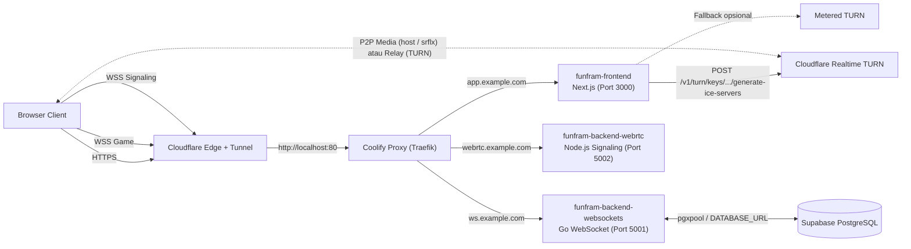

# Arsitektur Sistem Funfram

Dokumen ini menjelaskan arsitektur produksi **Funfram** (platform video chat acak berbasis lobby & multiplayer mini-games), alur komunikasi antar service, dan skema database.

---

## 1. Gambaran Umum & Topologi

Funfram terdiri dari **3 service independen** yang berjalan di balik **Cloudflare Tunnel (`cf-tunnel`)** dan **Coolify Proxy**:

---

## 2. Pembagian Service

| Service | Direktori | Tech Stack | Port | Tanggung Jawab |
| :--- | :--- | :--- | :---: | :--- |
| **Frontend** | `apps/frontend-nextjs` | Next.js (App Router, `output: 'standalone'`), Tailwind CSS, Zustand | `3000` | UI video chat & mini-game, WebRTC peer management (`WebRtcService`), API `/api/turn-credentials` |
| **Game & Matchmaking** | `apps/backend-websockets` | Go (`gorilla/websocket`, `pgx`) | `5001` | Lobby (`FRAME_*`), matchmaking queue (`SEARCH_START`, `FRAME_NEXT`), chat, status device, mini-game (`GAME_*`, `CANVAS_*`, `GUESS_SUBMIT`), HTTP `GET /health` |
| **WebRTC Signaling** | `apps/backend-webrtc` | Node.js (`ws`, `http`) | `5002` | Room signaling WebRTC (`join`, `peer-ready`, `offer`, `answer`, `ice-candidate`, `leave`), HTTP `GET /health` |

---

## 3. Alur WebRTC & Cloudflare TURN

Server rumah berada di balik `cf-tunnel` dan CGNAT ISP tanpa IP publik langsung, sehingga self-hosted Coturn tidak digunakan.

1. **Pengambilan Kredensial TURN:**
   - Saat inisialisasi, `WebRtcService.fetchCloudflareIceServers()` di frontend memanggil `GET /api/turn-credentials`.
   - Route Next.js (`apps/frontend-nextjs/src/app/api/turn-credentials/route.ts`) meminta kredensial ephemeral (TTL 24 jam) ke **Cloudflare Realtime TURN** (`rtc.live.cloudflare.com`).
   - Jika Cloudflare gagal dan `METERED_DOMAIN` + `METERED_API_KEY` tersedia di server, endpoint otomatis fallback ke **Metered API**.
   - Jika keduanya gagal, frontend tetap menggunakan `DEFAULT_ICE_SERVERS` (STUN Google & Cloudflare).
2. **Negosiasi Peer:**
   - Signaling server (`apps/backend-webrtc/server.js`) menentukan peran `offerer` / `answerer` lewat event `peer-ready`, lalu meneruskan `offer`, `answer`, dan `ice-candidate` ke target di room yang sama.
   - Browser memprioritaskan jalur ICE: `host` (LAN) → `srflx` (STUN / P2P) → `relay` (Cloudflare TURN).
   - Mode debug paksa relay tersedia di browser dengan `localStorage.setItem('FORCE_RELAY', 'true')`.

---

## 4. Database (Supabase PostgreSQL)

Skema referensi tersimpan di `infrastructure/postgres/init.sql` dengan tabel utama:
- `users`, `user_presence`, `user_device_state`
- `lobbies`, `lobby_members`, `invite_links`
- `matches`, `sessions`
- `leaderboard`

`apps/backend-websockets` terhubung melalui `DATABASE_URL`. Jika koneksi database tidak tersedia saat startup, backend tetap berjalan dengan fallback UUID sementara (`generateTempID()`) untuk state in-memory.
